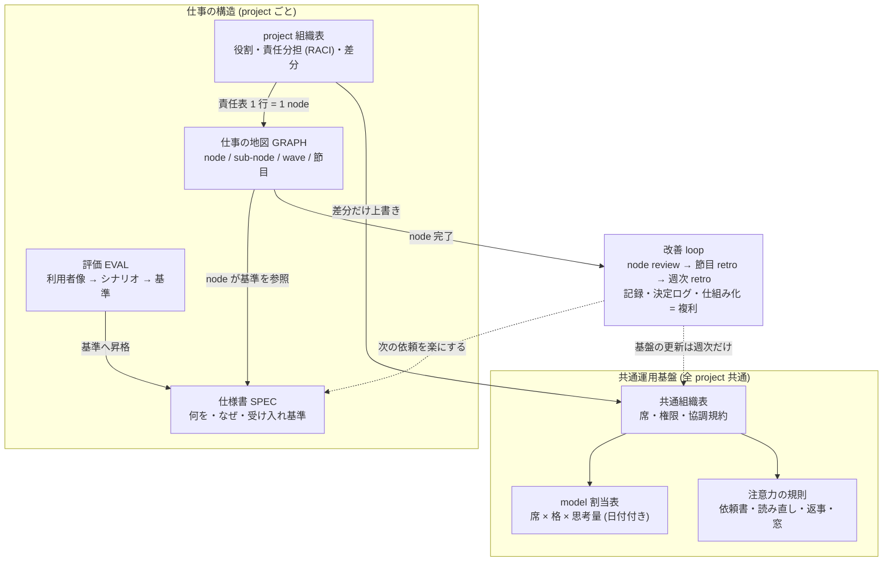
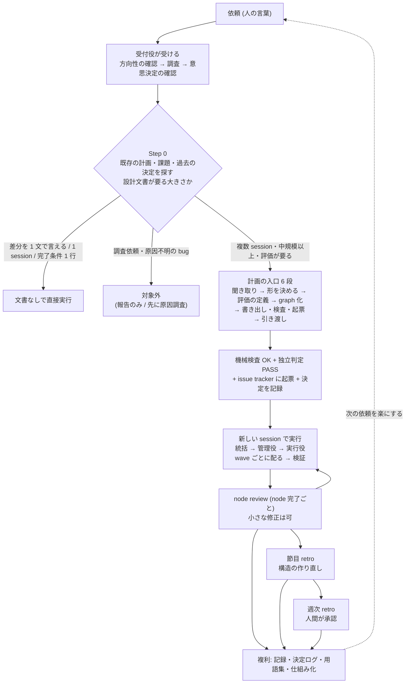
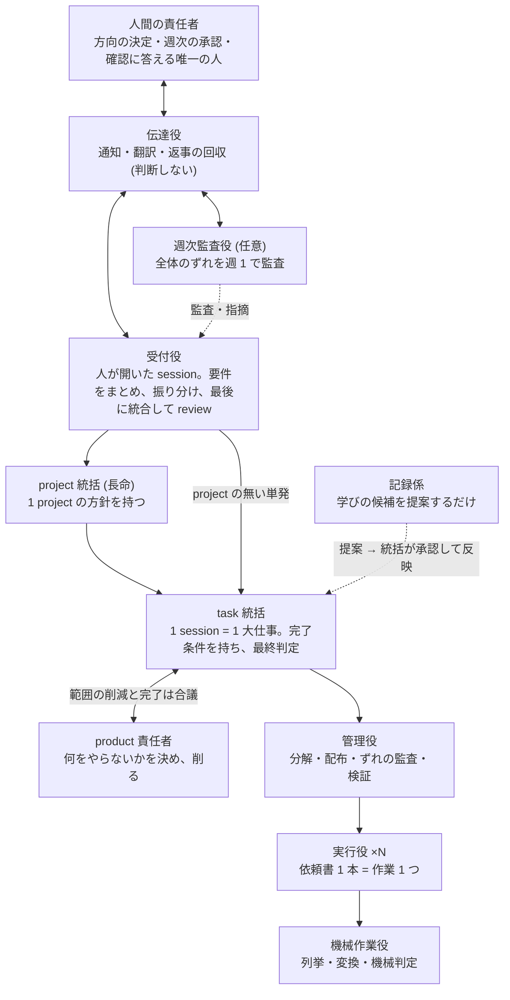
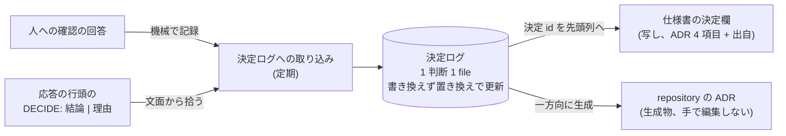
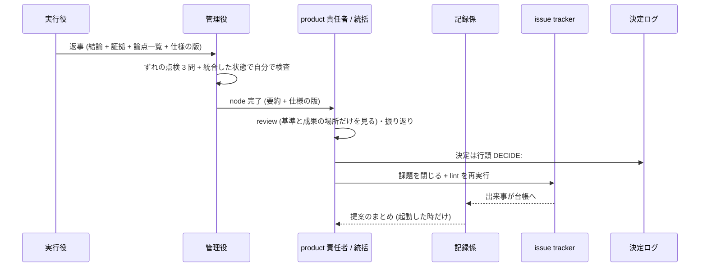

# Graph Compound Engineering — AI agent の組織で仕事を進める手引き

[English](HANDBOOK.md) | 日本語

> **これは何**: AI agent (自律的に作業する言語 model) の組織に、複数日・複数人分の仕事を任せるための進め方の手引きです。依頼を 3 つの設計文書に起こし、責任の重さで分けた「席」に agent を座らせて実行し、区切りごとの振り返りで次の仕事を楽にしていきます。
> **誰が読む**: agent 開発の一般知識はあるが、この仕組みを作った現場のことは知らない実務者 (agent に複数日の仕事を任せたい開発者・チームの責任者・agent 活用に関心のある人)。固有の tool 名やファイルの場所は出てきません。考え方 (どの現場でも変わらない部分) と「なぜそうするか」を中心に書いています。
> **最初に読む 3 節**: §1 何を解くか → §2 全体像 → §13 最小構成で始めるなら。語で詰まったら §15 用語集。問いから引くなら下の §0 の索引。
> **as-of**: 2026-11 時点の設計。例として出てくる「社内 FAQ bot」の案件は **架空** です (§5)。
> **作者・license**: Kazuaand / 本文は CC BY 4.0。

---

## 0. この文書の読み方

- 各節の先頭に **結論** (何のため・どうする) を置き、詳細は後ろに書きました。急ぐ時は各節の太字の結論だけ読めば全体がつながります。
- この仕組みの中の呼び名 (席・3 冊・戻し条件など) は、初めて出た所で「ここではこう呼ぶ」と定義し、§15 にまとめています。
- model (AI の頭脳にあたる部分) は具体名でなく **格 (tier)** で書きます。**最上位 tier** = 判断用の一番賢く高価な model、**上位 tier** = 管理や難所用、**中位 tier** = 実行の主力、**軽量 tier** = 機械的な作業用。model の名前や世代は数か月で変わるので、文書には役割だけを書き、どの model を当てるかは日付付きの別表で差し替えます (§11)。
- 「上位・最上位」は model の格にだけ使います。席 (§6) の位置は **上の席 / 下の席** と書いて区別します。
- **session** = agent との 1 回のまとまった会話 (起動から終了まで)。**窓** = model が一度に覚えていられる会話と資料の量 (context window)。有限なので、何を入れるかを設計します (§7)。

**問いから引く索引**

| 知りたいこと | 読む場所 |
|---|---|
| 何の問題を解く仕組みか | §1 |
| 3 冊はそれぞれ何を書き、なぜ分けるか | §4.1 |
| 「席」とは何か、model とどう違うか | §6 |
| 作る者と判定する者を分けるとは | §7.4 |
| 迷った時に人に聞くか・進むか | §8.1 |
| どこで止まって上に返すか (閾値の一覧) | §8.2 |
| 改善の loop | §8.4 |
| 自分の現場で何から始めるか | §13 |

---

## 1. この仕組みは何の問題を解くのか

**結論**: 大きめの仕事を agent に任せると、(1) 途中で目的からずれる、(2) 「できました」という自己申告がそのまま通ってしまう、(3) 今どこまで進んだかが分からなくなる、(4) 人間が細かい確認に追われて結局楽にならない、という 4 つの問題が起きます。この仕組みは、**何を・どの順で・誰がやるかを文書で固定し、作る者と判定する者を分け、振り返りで学びを仕組みに積む** ことでこれらを防ぎ、人間の関与を「方向を決めること」と「週に 1 回の承認」まで絞ることを狙います。積んだ学び (判断の理由を残す決定ログ、2 回起きた失敗を止める検査、揃えた用語集) が、次の依頼の聞き取りと検証を短くします (§8.5・§9)。

この仕組みは、次の 5 つの問いに答える形で組まれています。

| 問い | どこで答えるか |
|---|---|
| 何をやるか (なぜ・何が終われば完了か) | 仕様書 (SPEC) |
| どの順でやるか (何に依存するか) | 仕事の地図 (GRAPH) |
| 誰がやるか (誰が責任を持ち、どう協調するか) | 組織表 (ORG CHART) と席の梯子 |
| 何をもって完了か | 受け入れ基準と評価 (EVAL) |
| いつ見直すか | 改善 loop 3 段 (§8.4) |
| いつ人に聞くか | 判断 3 値と戻し条件 (§8.1・§8.2) |

名前の **GCE** は graph compound engineering の略です。「1 つの仕事が次の仕事を楽にするように積み上げる」という compound engineering (Every 社が 2025 年に広めた考え方) に、仕事の依存関係の地図 = **work graph** を足したものです。ここでの compound は「学びの複利」の意味で、部品を組み合わせる「compound AI systems」とは別の意味です。

---

## 2. 全体像 — 「仕事の構造」と「常設の組織」の 2 部品

**結論**: この仕組みは 2 つの部品からできています。**仕事の構造** (project ごとに書く: 何を・どの順で・どの役割が) と、**常設の組織** (全 project 共通: どの席にどの格の model を座らせ、各席の注意力をどう守るか) です。project ごとの組織表が常設の組織の席を指すことで、2 つがつながります。

### 2.1 3 層で見る

人のチームにたとえると、次の 3 層に分けると全体が 1 枚に収まります。

- **(A) 共通運用基盤** = 就業規則と設備。project に依らない。席の梯子・model の格の割当・注意力の規則・委譲・検証のやり方。人ではなく「機能の座席」です。更新は週 1 回の人間入りの振り返りでだけ行います。
- **(B) 役割** = その project で必要な専門家の分担 (品質の決定者・product 責任者など)。project ごとに違い、3 冊がこれを書きます。
- **(C) 役割 → 席の割当** = 役割を立てると、その判断の重さから基盤側が席と model の格を既定で決めます。人が毎回「この役割は一番賢い model で」と決めなくて済みます。

### 2.2 なぜ 2 部品に分けるのか

- 「何をやるか」と「誰がどうやるか」は変わる速さが違います。仕事は project ごとに毎回違いますが、席の分け方や注意力の守り方は何度でも使い回せます。混ぜると、project を 1 つ終えるたびに組織の規則まで書き直すことになります。
- 業界の「graph」は、仕事の流れと agent 同士のやり取りを 1 つの実行グラフに混ぜることが多いです。この仕組みでは **work graph の node は仕事であって agent ではない** と最初に決めています。agent (席) は組織表の側に書きます。

---

## 3. 1 周の流れ — 依頼から複利まで

**結論**: 依頼が来たら、まず既存の計画や過去の決定を探し、設計文書が要る大きさかを判定します。要るなら 1 回のまとまった作業 (session) で 3 冊と評価を書き、機械検査と独立判定を通してから、別の session に実行させます。実行中は node が終わるたびに review、節目ごとに構造の見直し、週に 1 回は人間入りの振り返りを回します。

各段で起きること:

1. **受付役が依頼を受ける**: 人間が開いた session の agent は「受付役」として振る舞い、自分では実装しません。まず目的・範囲・成功条件と見落としを確認し、調査 (重い読み込みは別の agent に任せる) をしてから、調査で新しく必要になった判断だけを、根拠・選択肢・推奨を付けて人に選択式で確認します。依頼の時点で目的と範囲がはっきりしていれば確認を省き、省いた理由を 1 行残します。
2. **Step 0 — 既存を探す / 文書が要るかを判定**: 同じ主題の計画・tracker の課題・過去の決定がないかを先に探します。あれば新しく起こさず、続きから再開するか既存の仕様書に変更を追記します。「差分を 1 文で言える・1 session で終わる・完了条件が 1 行」の小さな仕事なら、3 冊は書かずに直接実行します。調査の依頼と原因不明の bug は、この入口の対象外です (先に原因を調べる)。
3. **計画の入口 (kickoff) 6 段**: 1 回の session で 3 冊 + 評価 + 全体 note を書きます (§4.2)。この入口は自動では動かさず、明示的に呼んだ時だけ使います。
4. **引き渡しと実行**: 書いた文書を版管理に確定させてから、**別の新しい session** に「この仕事の地図を実行して」と貼って走らせます。計画を書いた会話の記憶を実行側に持ち込まないためです。実行側では統括役が全 node を見渡し、node ごとに管理役を 1 体立て、管理役が並列の束 (wave) ごとに実行役へ依頼書を配り、戻ってきた成果を自分で検証します。
5. **node review**: node が完了したら、作った席とは別の席が受け入れ基準を実行して確かめ、振り返りを書き、状態を更新します (§8.4)。
6. **節目 retro**: 計画時に決めた区切りに着いたら、仕様書・地図・組織表の構造そのものを見直します。
7. **週次 retro**: 週に 1 回、人間が承認者として入り、溜まった変更案を確定し、未確定の論点を棚卸しします。
8. **複利**: 改善 loop で出た学びを、記録 → 仕組み化 → 構造の議題 の順に昇格させます (§8.5)。判断は決定ログに、語は用語集に残します。

---

## 4. 3 冊 + 評価 + 全体 note — 何を書く文書で、なぜ分けるか

**結論**: **仕様書 (SPEC)** = 何を・なぜ・何が終われば完了か、**仕事の地図 (GRAPH)** = 何を・どの順で、**組織表 (ORG CHART)** = 誰が責任を持ち・どう協調するか。この 3 つを「3 冊」と呼びます。**評価 (EVAL)** は仕様書の受け入れ基準をどう観測するかを書く、仕様書に従属する文書、**全体 note** は 3 冊の外にある 1 頁の要約です。分ける理由は、変わる速さと書き換えてよい人が文書ごとに違うからです。

### 4.1 各文書が答える問いと、書き換えてよい人

| 文書 | 答える問い | 主な欄 | 書き換えてよい人 |
|---|---|---|---|
| **仕様書 SPEC** | 何を・なぜ・何が終われば完了か | 規模 (XS / S / M / L) + 目的 / 用語と境界 / 論点 / 受け入れ基準 / やらないこと / 決定 / 変更の追記欄 / 未確定 | 目的・受け入れ基準・やらないことは上の席と人間だけ。下の席は論点の状態の更新と変更の追記だけ |
| **仕事の地図 GRAPH** | 何を・どの順で | node (成果 / 参照する基準 / 依存 / stakes / 節目 / 状態)、sub-node、wave、節目 | product 責任者が作り、削る。状態欄は issue tracker に合わせる |
| **組織表 ORG CHART** | 誰が責任を持ち・どう協調するか | 席 / 席の配置と報告線 / 決定権 (責任分担表 RACI) / 引き継ぎと上申 / 変更の通り道 | 共通部分は週次 retro 経由でだけ。project 側は差分の上書きと project 固有の責任分担だけ |
| **評価 EVAL** | 受け入れ基準をどう観測するか | 利用者像 → シナリオ (Given / When / Then) → 基準への昇格 → 自動 test の場所、判定の規約 | 品質の決定者 (作った席とは別) が採否を付ける |
| **全体 note** | 全体像を 1 頁で | 目的の一文・文書の読む順・主要 node と節目の位置・削ったもの | product 責任者が節目ごとに更新 |

**なぜ 3 つに分けるのか**:

- **what と who を別の表にするのは project 管理の定番** です (作業分解 + 依存 = what、責任分担表 RACI = who × what)。1 枚にまとめると、仕事の分け方を変えるたびに責任の書き方も崩れます。別々に書き、node の id で 1 行ずつ接続すれば、片方だけを直せます。
- **書き換えてよい人が違う** からです。目的や完了条件は上の席だけが変え、実行側は追記しかできないようにしておくと、実行中に「基準を足す直し」が入って品質が逆に落ちる (退行) のを防げます。
- 文書間のつながり (node が参照する基準 id が仕様書に実在するか、責任表の各行に A がちょうど 1 人いるか、など) は **機械の lint (書式と接続の自動検査)** で確かめます。lint が見るのは id の切断と必須欄の欠落だけで、中身の良し悪しは独立判定に任せます。

### 4.2 計画の入口 6 段

**着手前に**: 段 1 の前に、一流の専門家ならこの仕事をどう進めるか (どの一次情報を見るか・実際にどんな方法を使うか・結果が正しいことを確かめる外部の確認は何か)、依頼者が本当に欲しいものは何か、指定が多すぎないか・足りないかを考えます。取り込むのは仕事を大きくせず良くする分だけで、**作った者以外の目による外部の確認 1 つ** は必ず完了条件に入れます。

| 段 | 目的 | 出力 |
|---|---|---|
| 1 聞き取り | 答えによって成果物の形が変わる問いと、まだ気づいていない未知を、調べる前に潰す。規模を決める | 目的の草案・規模・論点・仮の未確定・調査 note |
| 2 形を決める | 分岐を裁いて仕様書を確定する。用語・境界・中心領域・出来事の列 (DDD の戦略的な問い) を必ず問う。方向性の分岐を人に出す唯一の場 | 仕様書の全欄 |
| 3 評価の定義 | 受け入れ基準を観測できる形にする (振る舞いから基準を書き、test に落とす) | 評価文書 + 基準への昇格 |
| 4 graph 化 | 上段の node を先に決め、sub-node・依存・節目・責任分担を切る | 仕事の地図 + project 組織表 |
| 5 書き出し・検査・起票 | lint (構造) → 独立判定 → issue tracker に起票 → lint (完全) → 決定の記録 | 検査 OK・判定 PASS・課題 id |
| 6 引き渡し | 貼るだけで実行が始まる起動文を作る。自動では起動しない | 起動文 (参照先の実在を確認済み) |

- **評価の定義 → graph 化 の順は固定** です。評価を作る node を地図の先頭に置き、実装の node をそれに依存させます。「何をもって良しとするか」が決まる前に作り始めないためです。
- 言語 model の知識に無い領域 (社内固有の規程・新しい API など) を扱う時は、材料を集めて要約する **材料 node** を評価の node より先に置きます。
- 規模で重さを変えます。小さい仕事 (S / XS) は用語と境界の 2 欄だけ、中規模以上 (M / L) は用語・境界・中心領域・出来事の 4 欄を必須にします。

### 4.3 仕様書の中身

- **用語と境界 (Domain)**: 用語集 (正しい語 / 定義 / 旧い呼び名 / 未解決) と、責任の境界、何がこの仕事の中心価値か (中心領域)、起きる出来事の列。用語集は背骨です。地図や評価の中では用語集の語を太字で書き、lint が用語集に無い語を警告します。
- **受け入れ基準**: 検証方法は「どの command を実行すると何が出れば良いか」の形を優先します。自動判定の agent が tool を呼べない場合もあるので、結果が実行記録 (transcript) に残る形で書きます。
- **決定 (Decisions)**: 1 行 = 1 判断。文脈 / 決定 / 帰結 / 状態 の 4 項目 (ADR の書式) と、**出自** を書きます。出自は 2 種類です。**settled** = 人間が trade-off を見て選んだもの、**directive** = 統括役が決めたもの (人間はいつでも覆せる)。agent の推測は決定として記録しません。
- **変更の追記欄 (Deviations)**: 実行中の逸脱や変更を、本文を書き換えずに追記だけで貯める欄。状態は「仮置き (staged)」→ 週次 retro で「確定 / 却下」。
- **未確定 (Undetermined)**: §8.3。

### 4.4 仕事の地図の中身

- **2 層**: 上段の **node** = 人が 1 つの成果として認識できる仕事 (tracker の epic 1 つ、review の単位)。下段の **sub-node** = node を AI が 1 回で持てる大きさに細分した作業 (tracker の task 1 つ)。人は上段だけ見れば全体が分かります。
- **依存は sub-node 単位** で持ちます。
- **stakes**: node の必須欄。`proto` (やり直しが効く試作) か `prod` (取り返しがつかない・外部に影響する) か。
- **wave**: 同時に走らせる sub-node の束。同じ wave の中では書き込む file (lockfile や生成物も含む) を共有しません。wave の境目で管理役が検証します。
- **節目 (milestone)**: 計画時に決める「ここで方針を見直したい」区切り。外に見せる納期の意味ではありません。
- **agent や役割を node にしない**。node は仕事で、席は組織表に書きます。

### 4.5 組織表の中身

- **2 層**: 全 project 共通の組織表 + project ごとの差分 (上書きと project 固有の責任分担だけ)。検査は 2 つを重ねた状態で行います。
- **5 章**: 席 / 席の配置と報告線・通信路 / 決定権 (責任分担表) / 引き継ぎと上申 / 変更の通り道。
- **model の名前は組織表に書かない**。席の名前と、割当表への参照だけ書きます。model を替えるたびに組織表を書き換えないためです。
- **責任分担表 (RACI)**: 行 = 地図の node、列 = 席。R = 実行する、A = 最終責任、C = 相談される、I = 知らされる。**各行の A はちょうど 1 つ** (agent の席でもよい)、R は 1 つ以上。**人間の責任者の列は必須で空欄不可** です。A か R なら human-in-the-loop、C なら on-the-loop、I なら out-of-the-loop と読みます。人間を A に置くことは必須ではなく、人間を A/R から C/I へ段階的に下げていくことが「AI に任せられる範囲が広がった」ことの物差しになります (下げるのは 1 週に 1 段まで)。
- **本流 node**: `prod` の node か、節目の関門につながる node。この node の **規則** (自律の度合い・関門・採点基準・戻し条件) を変える時は、責任表で人間を下げていても人間が A のまま残ります。「仕事の実行」と「仕事の規則」を分け、下げるのは実行の側だけ、という考え方です。
- **並列書き込みの契約 (wave contract)**: ① wave の起点は版管理に確定済みの状態 (依頼書に起点の版を書く。未確定の作業中の状態から配らない) ② sub-node ごとに書き込む file を専有する ③ 実行役の版管理操作は自分の作業 branch への確定まで ④ 本流への統合・公開・履歴の書き換え・作業領域の削除は管理役以上 ⑤ 検証は作った実行役でなく管理役が行う。

### 4.6 評価の中身

- **利用者像 (persona)** には根拠の種類を 1 つ付けます。`evidence` (実在の資料・記録に基づく) / `research-grounded` (調査に基づく架空) / `free-synthetic` (根拠なし、印必須)。前の 2 つは同じく有効です。
- 利用者像を採用するかどうか (**curator 判定**) は、作った席ではなく品質の決定者が付けます。採用された利用者像から作ったシナリオだけが受け入れ基準に昇格できます。
- 利用者像は **用途で使い分け** ます。シナリオを作るのには使えますが、需要や割合の予測には使いません。
- **判定の規約**: 判定ごとに根拠の該当行を引用し、確信度は high / medium / low の 3 値 (high は引用必須)。判定者は作った席と別の席で、別の context (会話の記憶) で動かします。

---

## 5. 通しの例 — 社内 FAQ bot (架空)

**ここは架空の例です**。実在の会社・案件ではありません。3 冊がどう埋まり、1 周がどう回るかを具体的に見るためのものです。

**依頼**: 「総務への問い合わせが多いので、社員が chat で聞くと社内規程に基づいて答える bot を作ってほしい」

### 5.1 Step 0 と規模

- 既存の計画や過去の決定を探す → 似た計画は無い。
- 差分を 1 文で言えず、複数 session にまたがり、正しさの評価が要る → **規模 M**。計画の入口を使う。

### 5.2 3 冊の埋まり方 (抜粋)

**仕様書**

- 目的: 社員が chat で総務の質問をすると、規程の該当箇所を引用して答え、答えられない時は担当者へ回す。
- 用語集 (抜粋):

| 正 | 定義 | 旧い呼び名 |
|---|---|---|
| 規程 | 総務が管理する社内ルールの原文 | マニュアル |
| 回答 | 規程の引用を 1 つ以上含む bot の返答 | FAQ |
| 引き継ぎ | bot が答えられない質問を担当者へ回すこと | エスカレ |

- 境界: 規程の取り込み / 回答の生成 / 担当者への引き継ぎ。
- 中心領域: **回答の正確さと引用**。賢い model や評価の手間はここに厚く配り、chat 画面などは既製品で軽く済ませる。
- 受け入れ基準 (抜粋): AC-01「評価用の質問集を実行すると、引用付きの正答率が目標値以上と出る」/ AC-02「規程に無い質問では、答えずに引き継ぎへ回す」。
- やらないこと: 給与や人事評価の個別相談には答えない。
- 未確定: OPEN-01「目標の正答率はいくつか?」仮の扱い = 8 割 / 確定条件 = 総務の責任者が試行 20 問の結果を見て決める / 確定時点 = 実装中。
- 決定: 「回答には必ず規程の引用を付ける」出自 = settled (依頼者が引用なし案と比べて選んだ)。

**評価**

- 利用者像: P-01 入社 1 か月の社員 (根拠 = 過去の問い合わせ記録)、P-02 総務の担当者 (根拠 = 担当者への聞き取り)。どちらも品質の決定者が採用。
- シナリオ: Given 入社 1 か月の社員が / When 「交通費の精算期限は?」と聞く / Then 規程の該当条を引用して期限を答える → AC-01 へ昇格。

**仕事の地図**

| node | 成果 | 依存 | stakes | 節目 |
|---|---|---|---|---|
| N1 | 評価用の質問集と採点の仕組み (評価の node) | — | proto | M1 |
| N2 | 規程の取り込み (材料の node) | — | proto | M1 |
| N3 | 回答の生成 (検索・回答文・引用整形の 3 sub-node) | N1, N2 | proto | M1 |
| N4 | 担当者への引き継ぎ | N3 | proto | M1 |
| N5 | 社内公開 | N4 | **prod** | M1 の関門 |

wave 1 = N1 と N2 の sub-node を並列、wave 2 = N3 の 3 sub-node を並列 (書き込む file は別々)、という具合に切ります。

**組織表 (project 差分)**

- 役割を 1 つ足す: 「品質の決定者」(採点の採否だけを行い、点数は付けない。作った席とは別)。
- 責任分担表: N5 (社内公開) の A = 人間の責任者。N1〜N4 の A = task 統括、人間の列は C (相談される)。

### 5.3 1 周が回る様子

1. **実行**: 管理役が wave 1 の実行役 2 体に依頼書を配る。
2. **検証**: 実行役が「test は全部通りました」と返す。管理役はその申告を信じず、全員の成果を統合した状態で採点の仕組みを自分で実行する → 3 問落ちる → 差し戻しの依頼書を同じ実行役へ。
3. **戻し条件**: 回答生成の採点が 3 回続けて基準に届かない → 実行を止め、上の席へ「論点: 取り込んだ規程の版が古い可能性 / 仮の扱い: 最新版で再取り込み / 確定条件: 総務が最新版を確認」と記録を書いて返す。
4. **node review**: N3 が終わったら、作っていない product 責任者が AC-01 を実行して確かめる。振り返りで「規程の表が取り込み時に崩れる」を 1 回目として記録する。
5. **2 回目の再発** → 文章の注意書きを足すのでなく、取り込み時に表の崩れを検出する test を足す (仕組み化)。
6. **節目 retro (M1)**: 「引き継ぎを独立 node にしたのは分けすぎ」と判断し、地図の構造を直す。
7. **週次 retro**: 人間が溜まった変更を承認し、OPEN-01 の目標値を試行結果を見て確定する。

---

## 6. 席の梯子 — 「席」とは何で、model とどう違うか

**結論**: **席** とは、仕事の責任を持つ立場のことです。席は「判断の重さ」と「何に注意を向けるか」で分けた機能の座席で、model でも個人でもありません。同じ model が別の席に座ることもあります。上の席ほど判断が重く、注意を向ける範囲が広く、賢く高価な model を当てます。下の席ほど範囲が狭く、安い model や決定論の script で済ませます。指示は上から file で流れ、下からは短い要約と証拠の場所だけが返ります。

### 6.1 梯子の図

### 6.2 席の表

| 席 | 注意を向けるもの (役割) | model の格 | 権限・禁止 | 上へ返すもの |
|---|---|---|---|---|
| **人間の責任者** | 方向。週次の承認 | — | 基準・境界を超える変更の承認。本流 node の規則の A。確認を受けるのはこの人だけ | — |
| **週次監査役** (任意) | 全体の「決めたこと」と「実態」のずれ | 上位 + 中位 (監査の実行)、対話は最上位 | 監査と指摘が中心。権限は「監査 / 調整 / 片付け」のモードごとに書き分ける | 「こうなっているが合っているか?」の質問リスト |
| **受付役** | 人の意図 | 最上位 (思考量 多) | 自分で実装しない。作業が 2 つ以上・中規模以上なら必ず統括 → 管理役の経路に流す | 人間への報告 |
| **project 統括** | project の方針 | 最上位 (思考量 多) | 自分で実行しない。人に直接は聞けない | 統合の review とずれの監査 |
| **task 統括** | session の仕様と完了条件 | 最上位 (思考量 中) | 仕様を持ち、管理役を立てる。最終判定の責任 (A) | 要約 + 論点一覧 + 仕様の版 |
| **product 責任者** | 何をやらないか | 専用の席なし (統括と同じ session で兼ねる役割) | 仕様書と地図を削る権限、節目 retro の議長 | — |
| **管理役** | 実行役の出力と仕様の差 | 上位 (思考量 最大級) | 実装しない。目的・基準・やらないことは変えない。実行役の自己採点を完了扱いにせず、自分で検査を実行する | 結論 → 根拠 → リスク → 次 → 未確認 + 論点一覧 + 仕様の版 |
| **実行役** | 依頼書の作業 1 つ | 中位が既定。2 回失敗した時や、security・正しさ・設計判断が絡む時は上位 tier へ | 依頼書が指定した出力先だけに書く。人に直接は聞けない | 結論 1 行 + 証拠 + 論点一覧 + 仕様の版 |
| **機械作業役** | 機械的な正確さ | 軽量。決定論の script が使えるならそちらを先に | 判断しない。曖昧なものはそのまま返す | 出力先 + 件数 1 行 |
| **記録係** | 学びの候補 | 中位 (読み取りだけ) | 何も書き込まない。反映は統括が承認して行う | 提案のまとめ |
| **伝達役** | 人と各席をつなぐ | — | 判断しない | — |
| **役割 (project 固有)** | 例: 品質の決定者 | project ごとに足す | 作った席とは別の個体。採否を判定するが点数は付けない | 判定の記録 |

- **必須は 5 つの役割** = 人間の責任者 / task 統括 / product 責任者 / 管理役 / 実行役 (うち product 責任者は専用の席を持たず、task 統括の session が兼ねる)。他は規模に応じて足します。小さい仕事なら受付役が直接 task 統括を立て、project 統括は置きません。
- **構成は仕事に見合う最小に**: 席は責任と注意の分け方であって、毎回すべての階層に agent を立てる決まりではありません。たとえば管理役の責任 (分解・配布・検証) は必ず誰かが持ちますが、専用の agent を立てるか、統括が兼ねるかは仕事の大きさで決めます。どの model を座らせるかも、その時の適性・使える枠・費用で選びます。
- **1 席 1 語**。同じ語を 2 つの席に使わないでください (席の名前が文書ごとに揺れると、誰が何をするのかで必ず取り違えが起きます)。

### 6.3 上の席と下の席で何が違うか — 4 つの原則

1. **賢さは判断点に、実行は安く**: 高価な最上位 model は判断 (方針・ずれの監査・最終のまとめ) にだけ使い、実行は中位以下に任せます。実行役 (作る席) の出来は 8 割でよく、管理役・判定役 (見る席) が仕上げの水準に引き上げる、という分担です。具体的にどの model を当てるかは、日付付きの割当表で管理します (§11)。
2. **管理役を一番上の席にしない**: 管理役の上には必ず判断用の統括を置きます。管理役は手元の検証に注意を使い切るので、全体の方向を見る席が別に要るからです。薄い仕事でもこの形を崩しません。例外は「作業 1 つ・入力が揃っている・成果物が小さい・人がすぐ確認する」単発だけで、この時は統括から実行役へ直接渡してよいです。
3. **人に直接聞けるのは、人が開いた session の席 (受付役) だけ**: それ以外の席は、判断が要る時に推測で埋めず、「論点 / 仮の扱い / 確定条件」(または 質問 / 背景 / 選択肢 / 推奨) を書いた **blocked-record** を上の席へ返します。問いは梯子を上ります。過去の人の回答・既存の規則・仕様書・専門の agent や調べ物で決まるものは上の席が決め、人へ上げるのは お金・外への送信・本番・方向・ずれの恐れ に関わるものだけにして、受付役がまとめて聞きます。
4. **並列数には全体で 1 つの上限を置く**: 席ごとでなく、機械全体で同時に走る agent の数に上限を置きます (人間が後から追える数。初期値を決めて運用で調整)。上限を超えて広げても、検証と統合が追いつかず品質が落ちます。

### 6.4 行き詰まった時の上申 (escalation)

- 実行役が同じ作業で **2 回失敗** → 上位の格の実行役に替え、さらに最上位 model を **読み取り専用の相談役** として呼べるようにする (目安: 相談は 1 作業あたり 2 回まで、回答は短く、相談したことを記録する)。相談役を別の窓で動かすので、統括の窓を汚しません。
- それでも駄目 → 管理役が根本原因を調べる → 統括へ blocked-record で返す。
- **閾値は対象ごとに違ってよい** (実行役の失敗は 2 回、検査の連続失敗は 3 回、review の往復は 2 回で人間へ) のですが、どの閾値で誰に上がるかを **1 枚の表** にしておかないと、文書ごとに行き先がぶれます。この手引きの 1 枚表は §8.2 の末尾にあります。

### 6.5 外部の agent を席に座らせる時

- 別 vendor の coding agent や CLI も実行役の席に座れます。ただし **明示的に指定した時だけ** 使い、既定の経路にはしません。
- 別の環境で動く agent には、**その agent が座る席の契約 (返す形・完了条件・予算・人に直接聞かない) だけを強制** し、内部での委譲はその agent に任せます。強制する範囲を最小にした方が、環境ごとの差に強くなります。
- 外部の agent への依頼書は「手順まで書く」型にします。設計判断は統括が済ませてから渡し、統括の結論を事実でなく仮説として渡します。

---

## 7. 注意力エンジニアリング — 各席の注意を守る

**結論**: 上の席の **窓** (context。model が一度に覚えていられる会話と資料の量) は有限で、何かを入れれば何かが押し出されるゼロサムの資源です。だから判断のために空けておきます。具体的には、①各席の注意の焦点を 1 つに絞る ②依頼は file で渡す ③上へは短い要約と証拠の場所だけを返す ④作る者と判定する者を分ける ⑤決まった時点で仕様書を読み直す、の 5 つです。

### 7.1 依頼書は file で渡す

- 依頼書を書く前に、その作業を一流の専門家ならどう進めるかを考え、外部の確認 1 つを完了条件に入れます。人が受け取る成果物なら、受け手の像 (persona) の場所を依頼書に書きます。
- 依頼は会話文でなく **1 つの file (依頼書、brief)** にし、上の席は file の場所と版だけを持ちます。仕様書の中身を写さず、**場所と差分を渡す** (要約を渡さない) のが原則です。受け手が元の情報を自分で読めるので、要約での取りこぼしやずれを防げます。「薄い依頼書を受けた強い model は、全部の文脈を受けた弱い model に負ける」と言われます。
- **依頼書の 9 項目**: 目的 / 論点 / 作業 1 つ / 入力の場所 / 完了条件 (DoD) / 予算 (token と時間) / 止まる条件 (stop point) / 出力先 / 禁止事項。末尾に仕様の版を書き、返事にその版を写させます。この 9 項目は AI に限らず、外注先や同僚への依頼にもそのまま使えます。止まる条件は個々の作業の区切りで、§8.2 の戻し条件 (上の席へ返す条件) とは別物です。
- 自走力の高い上位 model に渡す依頼書には、予算・完了条件・止まる条件を必ず入れます。強い model ほど作業を広げ過ぎたり、止まらずに長く走り続けたりするからです。「検査が通ったら報告して止まる。頼まれない限り追加の review は始めない」といった止め方も依頼書に書きます。
- 決定事項を渡す依頼書には「確定済みの決定が成り立たない証拠を見つけたら、黙らずに報告する」を固定の文で入れます。

### 7.2 決まった 4 つの時点で仕様書を読み直す

① 依頼を配る前 ② 返ってきた成果を検証する時 ③ 再開・context の圧縮・引き継ぎの直後 (最初の行動 = 仕様書を読む) ④ 上へ報告する前。

管理役は返事が来るたびに **ずれの点検 3 問** を当てます: 完了条件に当たっているか / 範囲外に踏み込んでいないか / 仕様書に無い仮定を作っていないか。結果は「直して通す / 依頼し直す / 上申」のどれかです。上の席は節目と最終報告の前にだけ、要約と仕様書を読みます。

### 7.3 版の指紋で「古い仕様で作っていないか」を見る

仕様書を変えるたびに版番号を上げ、ファイルの hash (内容から計算する指紋) の先頭数桁を版の印にします。依頼書と返事の両方に版の印を書かせ、受け手が現行の版と文字列で比べ、違えば差し戻します。分かるのは「古くない」ことだけで、「読んだ」ことの証明ではありません。印の形 (何桁か、版番号か hash か) は 1 つに決めておきます。仕様書を改訂したのに版番号を上げ忘れると、この仕組みは静かに効かなくなります。

### 7.4 作る者と判定する者を分ける (evaluator ≠ generator)

**何か**: 成果を作った席 (generator) が、自分の成果を最終判定しない。判定は別の席 (evaluator) が、別の窓で行う。上の席は常に判定する側に立ちます。

**なぜ必要か**:

- **自己申告は証拠にならない** からです。長く走る agent は「改善しました」「全部通りました」と申告しがちですが、実測すると改善していない・悪化していることがあります。作った本人は、自分が見落とした所をそもそも見ていません。
- **同じ文脈の 2 つの視点は、2 人の証人ではなく 1 人の 2 つの視点にすぎない** からです。同じ会話の続きで「今度は review 役として見て」と頼んでも、作った時の思い込みをそのまま引き継ぎます。だから別の窓 (会話の記憶を引き継がない別個体) で判定します。同じ model でも構いませんが、同じ窓や、会話を引き継いだ分身は判定者になれません。
- **判定者に経緯を見せない**: 判定者に渡すのは仕様書と成果物の場所だけです。作った側の説明や推論を見せると、それに引っ張られます (anchoring)。

**運用の決まり**:

- 2 段で見る: ① 管理役が実行役の成果を評価する ② 管理役のまとめを、context を持たない新しい判定役が評価する。
- review の往復は 2 回まで、3 回目は人間へ。既定は「直して通す」。判定中に基準を増やす直しは、範囲の変更として扱います。
- 判定役の選び方は対象の性質で決め、1 枚の表にします。

| 対象 | 判定の仕方 |
|---|---|
| 正誤が再現できる実証 (test・公式の記述・決定論の tool) で決まる / ごく小さい仕事 | 判定を省き、実証の結果を 1 行書く |
| 範囲が確定した計画・内部の成果物 | context を持たない別個体の判定役 1 体 |
| それ単体で読める対象 (code の差分・一般的な設計・論理の整合) | 別 vendor の model による判定 |
| 探索的で前提が揺れる計画 | 上の 2 つを並列に走らせる (どちらも助言、裁定は統括) |
| メタな見方が要る review | 人間が明示した時だけ、最上位 model の判定役 |

### 7.5 窓に入れてよいもの・入れないもの

| 入れてよい | 入れない |
|---|---|
| 依頼者の原文 / 仕様書の場所と版 / 決定とその理由 / 短い要約 / 未決の分岐 / 環境の要点 1 行 | 長い file の本文 / 差分 / log や取得結果 / 下の席の agent の実行記録 / model の説明書の本文 / 待機中の画面の監視 / 探索の途中経過 |

- 待つ時は画面を監視し続けず、状態が変わった通知だけを受け、状況は状態 file を自分から読みに行きます。
- 作業が長引いたら、状態 file に寄せて新しい席へ引き継ぎます。長く止まっていた session は同じ会話に戻さず、仕様書の場所 + 状態 file + 依頼者の原文を持たせて新しく始めます (止まっている間に cache が切れて、戻しても安くも速くもならないため)。閾値の数値は環境依存なので、1 箇所にだけ書きます。

### 7.6 返事の形と論点一覧

- 上へは要約だけを返します (目安 1〜2 千 token)。順序は **結論 1 行 → 根拠 (file と行) → リスクと trade-off → 次の一手 → 未確認の点**。長い summary・log の貼り付け・「完了しました」だけ、は差し戻します。
- 末尾に **論点一覧** を 1 行付けます。例: `論点: Q1=closed(根拠の場所) Q2=open(理由)`。活動報告に押されて「未解決の問い」が消えるのを防ぐためです。id が欠けていたら、ずれの合図として差し戻します。

### 7.7 相手の型に合わせて依頼書の書き方を変える

指示の細かさは model の格に反比例させます。上位の model ほど目的と制約と完了条件だけを渡し、手順を細かく書くと逆に性能が落ちます。

| 相手の型 | 渡すもの | 避けるもの |
|---|---|---|
| 最上位 (判断・判定) | 目的 1〜2 文 + なぜ + 検証できる完了条件 1 行 + 止まる条件 1 文 + やらないこと | 手順の列挙、念押しの再検証の強制、推論を書き出させる指示 |
| 上位 (管理・難所) | 完全な仕様を 1 通で (目的 + 「完了とは…」+ いつ止まって聞くか)。入力は揃えて渡す | 「最後に検証して」「二重に確認して」などの過剰な検証の指示、途中で規則を足すこと |
| 中位 (実行) | 1 通目に作業・理由・制約・範囲・具体的な閾値を全部。完了条件は実際の検査 (test・build・型検査) | 「控えめに」「重要なものだけ」(拾い漏れが増える) |
| 軽量 (機械作業) | 手順・参照する file・開始地点 + 機械で判定できる完了条件 | 設計や見た目の判断、曖昧な目的 (曖昧さはそのまま返させる) |
| 外部の coding agent | 手順まで。参照する型・開始地点・機械判定の完了条件・触らない範囲。数時間以内に分割 | 設計の丸投げ、統括の結論を事実として書くこと |

### 7.8 人が見る画面と見ない画面を分ける

- 別の session を立てる時、**人が対話したり確認したりする価値がある席** (受付役・統括) だけを人から見える画面に置き、人が触らない席 (管理役の下・機械作業・外部 agent の内部) は見えない画面で動かします。基準は model の格ではなく、人が関わる価値があるかどうかです。
- 見えない画面の session が、親がいなくなったのに人を必要としている時は、**自分で見える画面に上がる** ようにします。黙って止まったままにしません。

---

## 8. 運用規約

**結論**: 迷ったら「判断 3 値」で扱いを決め、決めきれない論点は未確定として登録して先へ進み、5 つの戻し条件のどれかが起きたら実装を止めて上の席へ返します。振り返りは 3 段の改善 loop で回し、共通の規則と雛形の変更は週次 retro でしか確定しません。

### 8.1 判断に迷った時の 3 つの扱い方 (判断 3 値)

| 扱い | いつ | 何をする |
|---|---|---|
| **人に聞く** | 合意済みの目的・範囲・権限の外に出る判断 / 新しく人の選択が要る重要な分岐 (境界・止めるかどうか・取り返しがつかない・影響が大きい `prod` の node を含む) | 人間の責任者に根拠・選択肢・推奨を付けて確認する。聞けるのは人が開いた session の席だけ。成果物の形が変わるだけなら、合意済みの権限の内側かを先に照らす |
| **仮定を登録して進む** | 調べれば分かるが今は確かめられない / やり直しが効く・影響が小さい | 仕様書の未確定欄に 1 行足し、仮の扱いで進む |
| **進む** | 事実を調べれば決まる / やり直しが効く / 仕様書の中で閉じている | そのまま進む |

- 人に聞くかどうかの基準は **仕事の大きさではなく、論点 (見落とし・矛盾・不明点) があるかどうか** です。小さい仕事でも論点があれば聞き、大きい仕事でも論点が無ければ聞きません。
- 作業中に出た分岐は未確定として登録して進み、**区切りの最後にまとめて** 聞きます。人を何度も呼び戻さないためです。
- 人がいない時、合意済みの権限を超える判断や重要な選択は仮定で確定させず、blocked-record (論点 / 選択肢 / 推奨 / 依存する作業 / 確定条件) にして上の席へ返し、回答に依存しない作業は進めます。やり直しが効く小さな不明点だけを未確定に登録して進みます。

### 8.2 途中で止まって上に返す条件 (戻し条件 5)

次のどれかが起きたら、実装を続けずに blocked-record を書いて上の席へ返します。計画中も実行中も常に有効です。最初に入れるなら 1〜4 の 4 つ、決定ログを運用し始めたら 5 を足します。

1. **検査の 3 回連続失敗**: lint・独立判定・受け入れ検査のどれかが、同じ対象で 3 回続けて失敗した。同じ検査への修正が 2 回効かなければ、闇雲に直し続けず、2 つの修正が頼っていた前提を名指しで点検してから 3 回目に進む。
2. **仕様の外の判断**: 受け入れ基準・やらないこと・決定のどれにも当たらない判断が要る。
3. **未知の障害で一定時間 (目安: 30 分) 進まない**。
4. **担当範囲の超過**: node の範囲を超える作業が要る (所有していない file への書き込みを含む)。
5. **確定済みの決定が崩れる証拠** が出た。

- **証拠の無い返事は、戻し条件ではありません**。下の席の返事が「完了 + 証拠 (実行した検査の出力か成果物の場所)」の形になっていない時は、検証役・評価・lint の側で止めて直させます。機械で確かめられる品質の問題 (証拠の無い完了・中身の無い報告など) まで上の席や人へ上げると、人の注意を一番安い問題に使うことになるからです。人へ上げるのは、お金・外への送信・本番・方向、それに確定した決定が崩れる時だけにします。
- この仕組みでは、予算の上限 (「ここまで使ったら止める」) ではなく、この戻し条件で止めます。定額制で利用する環境では予算額より「沼にはまったら戻す」方が実態に合うからです。

**閾値と行き先の 1 枚表** (数値は目安。自分の環境で決め直し、この表 1 か所にだけ書く)

| 起きたこと | 閾値 | 次にどうするか | 行き先 |
|---|---|---|---|
| 実行役が同じ作業で失敗 | 2 回 | 上位 tier の実行役に替え、最上位 tier の相談役を呼べるようにする | 管理役が判断 |
| 格を上げても失敗 | — | 管理役が根本原因を調べ、blocked-record を書く | 統括 |
| 同じ対象の検査が連続で失敗 | 3 回 (2 回目の後に前提を点検) | 実装を止め、blocked-record を書く | 上の席 |
| review の往復 | 2 回 | 3 回目は人へ | 人間の責任者 |
| 未知の障害で進まない | 目安 30 分 | 実装を止め、blocked-record を書く | 上の席 |
| 仕様の外の判断・範囲の超過・決定が崩れる証拠 | 1 回で | 実装を止め、blocked-record を書く | 上の席 (方向に関わるなら人まで) |
| 返事に証拠が無い | 1 回で | 検証役が差し戻して直させる | 上げない |

### 8.3 未確定を隠さず登録する

- 話し合った後もまだ決められない論点は、「未定である」と明記して登録し、運用の中で決めます。最初から何も決めない (すぐにずれる) のとは別物です。
- 欄: 論点 (疑問形) / **仮の扱い** (必須。空なら未確定ではなく、先に人に聞くべき blocker) / 確定条件 (誰が・何を見て・どうなったら決まるか。「検討が済んだら」は不可) / 確定時点 (着手前 / 実装中 / 運用後) / 状態 / 計画を止めるか (yes なら確定まで地図づくりや引き渡しを進めない。yes にするのはお金・外への送信・本番・方向に関わる未決だけにし、他は no にして仮の扱いで進む)。
- 確定しても行は消さず、確定にして内容と日付を足し、結論を決定欄へ移します。
- 人が「仮置きは全部それで良い」とまとめて答えた時も、各行と責任表に書き戻さないと未確定のまま残ります。

### 8.4 改善の loop は 3 段

| 段 | いつ | 誰が | 何をする |
|---|---|---|---|
| **node review** | 地図の node が完了した時 | product 責任者と task 統括 (作った席とは別) | **小さな修正 (patch) は可**。受け入れ基準を実行して確かめ、失敗を記録する。構造の作り替えはここでは確定せず、記録に回す |
| **節目 retro** | 節目に含まれる node が全部終わった時 | product 責任者 (議長) と統括 | **構造の作り直し**。仕様書・地図・組織表の境界・分割・依存・席を見直す。目的や基準に及ぶ変更は週次へ上げる |
| **週次 retro** | 毎週決まった曜日 + 障害・苦情・model の切替・ずれの検知 | 統括側が準備し、人間が承認 | **基準そのものの見直し**。溜まった変更の確定、未確定の棚卸し、人間の関与を下げられる node の判断 |

- **3 段に分ける理由**: AI は目の前の失敗に patch を当てる方向 (bottom-up) に寄りやすいからです。窓に入るのは 1 件の不具合だけで、報酬も局所的で、全体を削る権限も記憶も持っていません。だから、全体像と削る権限を持つ席・複数の不具合をまたぐ記憶・削減を進捗として数える場、の 3 つを別に用意します。
- **切り替えの軸は回数ではなく原因の所在** です。その場限りの原因 (特殊原因) なら patch、仕組みに由来する原因 (共通原因) なら構造の作り直し。
- 上の席は下の席の要約を受け取りますが、要約には元の記録や成果物への参照を必ず付けさせ、抜き取りで検算します。下の席の自己申告は信用の材料にしません。
- 常駐の指示を増やす提案をする時は、同じ回で同じ量の削除候補を並べます (指示は有限の予算で、足すほど一つ一つが効かなくなるため)。
- 新しい仕組みの間は週次、安定したら月次に緩めてもよい (人間が retro で決める)。

### 8.5 学びの昇格 (記録 → 仕組み化 → 構造の議題)

| 段 | 条件 | 扱い |
|---|---|---|
| 1 記録 | 初めて起きた | 台帳に学びと元の記録への参照を残す。規則にはしない |
| 2 仕組み化 | 同じ失敗が 2 回 | 文章の注意書きを足さず、hook・lint・test などの決定論の仕組みで止める |
| 3 構造の議題 | 仕組み化したのに再発 / 2 つ以上の面に波及 / retro で同じ指摘が 2 回 | 節目 retro の議題の先頭に置き、3 冊の作り直しを検討する |

- **記録の入口**: 再利用でき、再現条件が書け、出典が 1 つある学びだけを記録します。「この記録が消えても、次の人が最終成果物を読めば同じ失敗を避けられるなら記録しない」。
- **未処理の学びを残す規則**: 未処理の指摘を、人が見る残る場所 (tracker の課題か報告の本文) に書くまで、node を完了と報告しません。

### 8.6 人がいない時の扱い (human gate)

- 人が関わる箇所 = 責任表で人間が A か R の node + 取り返しのつかない操作 (削除・送信・課金・履歴の強制上書き)。それぞれに「重要 (critical) かどうか」と「人がいない時にどうするか」を決めておきます。
- 梯子: ① 親の席が応答できる → 親へ上申し、親が人に聞く ② 人がいない × 重要でない → 推奨案 (未確定の仮の扱い) で進み、変更の追記と blocked-record を残す ③ 人がいない × 重要 → そこまでを完了にし、判断材料をまとめた 1 枚を出して停止する。
- 人への問いには、推奨・重要 (critical) かどうか・既定の期限 (例: 問いから 2 時間後) を付けます。期限を過ぎたら、重要でない判断は推奨で進めて変更の追記欄に仮置きで残し、重要な判断は保留のまま待ちます。費用のかからない・やり直しの効く調べ物は回答を待ちません。
- 確認の問いが長時間放置されて自動で取り消されても、それは承認ではありません。沈黙・時間切れ・不在・配送の失敗は、どれも承認として数えません。
- 人が別の画面にいる時は、**質問を file で渡し、回答を file で受ける** 経路が有効です。席の表にこの経路と、回答を代わりに伝える役を書いておきます。

### 8.7 変更の通り道 (change control)

- 席の追加・交代・権限・協調規約の変更は、変更の追記欄に仮置きで書く → 週次 retro で人間が承認 → 正本 (共通の組織表・model 割当表) を書き換え、決定ログで古い決定を置き換える、の順で通します。日々の変更は product 責任者が判断し、人間の承認は新しいことと境界を超えることだけにします。
- 席の規則だけでなく、**手順の規則 (計画の入口・雛形・lint・review の手順・注意力の規則) も同じ通り道を通す** ことを明記してください。対象を席の変更だけに書くと、手順の変更が承認なしで正本に入り込みます。

---

## 9. 記録と loop

**結論**: 判断の「なぜ」は決定ログに、作業の状態と依存は issue tracker に、構造は 3 冊に、長く使う知見は knowledge base に、人向けの報告は報告置き場に、と **1 種類の情報 = 1 つの置き場** にします。記録係は昇格すべき候補を提案するだけで、書き込むのは統括です。

### 9.1 判断の流れ — 決定ログ → 仕様書の決定欄 → ADR

- 判断の「なぜ」の正本は **決定ログ** (1 判断 = 1 file、書き換えず、新しい判断で置き換える連鎖で更新) に置きます。ADR (判断の文脈・決定・帰結・状態を 1 件ずつ残す既存の書式) はその部分集合で、長く使う code repository には決定ログから一方向に生成します。読み戻しはしません。正本を 1 つに保つためです。
- **記録の経路は 2 つ**: (a) 人への確認の回答は、問い・選択肢・選んだものを機械で記録する。(b) 会話の中で決まったことは、統括が応答の行頭に `DECIDE: 結論 | 理由` と書き、後段が拾う。(b) は「書くかどうか」が agent に依存するので、session を閉じる時に「書き忘れた決定はないか」を思い出させる手順を置きます。
- **出自を写す**: 決定ログには「人が決めた」のか「統括が決めた・追認した」のかを必ず残します。全部を「人が決めた」と記録すると、後から読んだ時に統括の判断を人の裁定と取り違えます。

### 9.2 記録係 (scribe)

- 出来事 (確認の回答・課題の完了・node review の報告・版管理の確定・人が書いた決定や学び) を hook が台帳に **追記だけ** します。
- 記録係はその台帳をまとめて読み、昇格すべき候補を「提案のまとめ」として返します。自分では何も書き込みません (読み取り専用)。候補の種類は「記憶 / 規則 / knowledge base / 課題 / 観測のみ / 仕組み / 構造の議題 / 不要」。規則の候補には、相殺する削除候補を必ず付けます。
- 記録係は常駐させず、出来事か閾値で起動する background の job にします。何を残すかの判断だけを安い model に任せ、保存・検索・期限の管理は決定論で行います。
- **注意**: 「台帳に追記する」だけ自動にして「まとめて読む」を誰も起動しないと、記録係は一度も働かないまま「実装済み」と書かれがちです。起動の配線まで確かめてください。

### 9.3 報告の単位は「節目」

- 人への報告は、会話の 1 往復や session ごとではなく、**node review や課題の単位** で出します。1 つの仕事 = 1 つの報告ページを上書きし、画面を増やしません。
- 報告は「読者は何も覚えていない」前提で、何の仕事か・今どうなっているか・本当に人がやるべきことは何か (無ければ「なし」) を先に書きます。

### 9.4 issue tracker の役割

- 作業の状態と依存の正は issue tracker です。node = epic、sub-node = task。依存は向きを間違えると全体が逆転して気づきにくいので、作った後に依存の木を表示して向きを確かめます。
- 線引き: tracker = 作業・依存・再開 (動く情報) / 決定ログ = 判断の理由 (変えない情報) / knowledge base = 長く使う知見 / 3 冊 = 構造の正本 / 報告 = 人向けの配送物。
- **状態の正を 1 つに決める**: 地図の状態欄・tracker・仕様書の基準の状態欄・進捗 note・review の記録、と状態を書く場所が増えると、全部がずれます。どれが正で、どれが写しかを最初に決め、写しは自動で更新するか、持たないことにします。

### 9.5 session の終了と、計画上の節目は別物

session を閉じる時の片付け (記録・未完の起票・確定) と、計画上の節目 (node の完了) は別の出来事です。session を閉じても node は完了しませんし、node の review は session の終了では始まりません。2 つをつなげる場合は、つなぎ目を明示してください。

---

## 10. 機械で守る規則と、散文で守る規則

**結論**: 規則は「機械で止めるもの」と「散文 (文書の約束) で守るもの」に分け、どちらなのかを正直に一覧にします。機械で止める (deny) のは、誤用だと高い確度で分かるものだけにし、それ以外は警告に留めます。「lint で守られているはず」と思い込んで確認を省くのが一番危険です。

### 10.1 強度の段階

| 強度 | 意味 |
|---|---|
| **止める (deny)** | tool の呼び出しや確定を止める |
| **1 回差し戻す** | 終了時の検査が 1 回だけ差し戻す |
| **警告** | 注意を足すだけ |
| **配線なし** | 検査の道具はあるが、自動では呼ばれない |
| **散文のみ** | 機械が無く、文書の約束だけ |

### 10.2 よくある配置の例

| 規則 | 典型的な強度 |
|---|---|
| 人がいない間は人への確認を出さない | 止める (不在の印が立っている間だけ) |
| 長く止まった agent を同じ会話で起こさない | 止める |
| 取り返しのつかない操作 (データ削除など) | 止める (対象を限定して) |
| 下の席に高価な最上位 model を割り当てない | 止める (明示的な上書きは可能に) |
| 外部 agent を明示なしで起動しない | 止める |
| 依頼書の必須項目 | 警告 (項目名の文字列があるかを見る程度) |
| context の残量 | 警告 |
| 証拠の無い完了報告 | 検証役・評価・lint で止めて直させる (人へは上げない) |
| 3 冊の id のつながりと必須欄 | lint で失敗にできるが、**自動で呼ぶ配線が無ければ散文と同じ** |
| 戻し条件・版の照合・作る者 ≠ 判定する者・読み直しの時点・ずれの点検 3 問 | 散文のみになりやすい |

- 機械を増やすのは、学びの昇格の「2 回目」が実際に起きてからにします。先回りで足すと、誤検知で正しい作業を止める機械が増えます。
- その代わり、**文書が機械の強さを実際より強く書かないこと** が大事です。「lint が必須」と書いてあっても自動で走らないなら、誰がいつ呼ぶかを書いてください。

### 10.3 固定するのは境界だけ

- 指示・規則・組織の設計では、目的・制約・完了条件・理由を渡し、判断ややり方はその時の model に任せます。
- 決め打ちで固定するのは、model が賢くなっても残る理由があるものだけです: 取り返しのつかない操作 (お金・外への送信・本番・データの消失)・権限・上限・外部の検証 (別の評価者・決定論の採点・人)。
- 手順や追加の仕組みは「今の model の弱点への仮説」として外しやすく作り、新しい model が出たら評価で測って、要らなくなったものを外します。順序そのものが要件である手順は残します。
- 合格の条件や点数を決めた時は、「その条件を、仕事をせずに満たす方法は無いか」を考え、その抜け道を塞いでから使います。

---

## 11. 道具が変わっても変わらない部分 (Port と Adapter)

**結論**: 不変の役割・契約 (**Port**) と、差し替え可能な具体の道具 (**Adapter**) を分けて書きます。席・依頼書の項目・返事の形・作る者 ≠ 判定する者は Port、どの model をどの思考量で座らせるか・どの agent CLI で動かすかは日付付きの Adapter です。

| Port (変わらない) | Adapter の例 (差し替えられる) |
|---|---|
| 受付役・統括 = 判断の席 | 最上位 model × 思考量 多 / 中 |
| 管理役 = 分解と検証 | 上位 model × 思考量 最大級 |
| 実行役 = 作業 1 つ | 中位 model が既定、難所は上位 model + 最上位の相談役 / 別 vendor の coding agent (明示時のみ) |
| 機械作業役 | 軽量 model、または決定論の script |
| 依頼書 = file / 論点一覧 / 仕様の版 | agent CLI の起動時の検査 / 外部 agent では PR 本文の末尾に書かせる |
| 人が見る画面・見ない画面 | 見える作業画面 / 背後で動く画面 |
| 独立判定 | context を持たない別個体 / 別 vendor の model |

- **Adapter の表には日付と再評価のきっかけを書きます** (新しい model が出た / 設定が変わった / 使用量が偏った / 小さな評価で結果が変わった)。
- 安い格を採用する時は、cost だけで決めず、**同じ問題を見つけられることを評価で示してから** にします。
- 1 つの agent CLI で全層を動かす場合は全部の規則を揃えられますが、別 vendor の CLI を最上位に据える場合は、§6.5 のとおり最上位の契約だけを強制し、内部は任せます。

---

## 12. 運用して分かったこと

この仕組みを実際の project で回してみて分かったことを、固有の事情を外して書きます。

**よく効いたこと**

- **体験の指標を受け入れ基準にした**: 「動くかどうか」だけでなく「利用者が待たされないか」などの体験の数値を基準にしたことで、機能は揃っていても体験の基準を満たしていない所が早い段階で見えました。数値の目標を仮置きにし、人が決める点として記録できたのも良かった点です。
- **統合した状態で検証し、自己申告を信じなかった**: 実行役の「全部通った」という申告を、管理役が統合後の状態で実際に検査し直すと、申告と違う結果が出ることがありました。別の project でも同じことが起き、これは仕組みとして残す価値があります。
- **質問を file で渡す経路**: 人が別の作業をしている間も、質問 file と回答 file で判断を受け取れ、短時間で論点が閉じました。

**ずれたこと**

- **状態の置き場が多すぎた**: 地図・tracker・仕様書の基準欄・進捗 note・review の記録に状態を書いた結果、全部が少しずつずれ、「今どこか」が分からなくなりました (§9.4)。
- **仕様の版番号を上げ忘れた**: 仕様書を何度も改訂したのに版番号が据え置かれ、版の照合は「古い版でも差分を確認したら許す」という例外で回すことになりました (§7.3)。
- **管理役が黙って止まった**: 外部 agent の接続エラーの後、管理役が返事も blocked-record も残さずに止まり、長い間誰も気づきませんでした。停滞を検知する仕組み (一定時間返事が無ければ上位に知らせる) が要ります。
- **戻し条件が発火しなかった**: 文面上は「3 回連続失敗」に当たる場面があったのに、blocked-record が書かれず、再開の指示書にも戻し条件が入っていませんでした。散文だけの規則は、依頼書に毎回書き込まないと忘れられます。
- **機械で直せる問題を人へ上げる設計になっていた**: 「下の席の返事に証拠が無い」を戻し条件に入れていたため、検査の側で直せる品質の問題まで上の席や人へ上がる形になっていました。戻し条件から外し、検証役・評価・lint で止めて直させる形に改めました (§8.2)。
- **席の交代が記録されなかった**: 再開の時に管理役の席を別の agent に替えたのに、組織表にも変更の追記欄にも書かれませんでした。

**小さい仕事の回し方**: 3 冊を作らず、「仕様の差分 (不具合 → 根本原因 → 修正の対応表 + 受け入れ基準 + やらないこと + 未確定)」+「指示書」+「結果の記録」の 3 file だけで回した小さな改修も、本番への反映まで問題なく進みました。§13 の最小構成はこの経験に基づいています。

---

## 13. 最小構成で始めるなら

**結論**: 全部をいきなり入れる必要はありません。次の順で、効果が大きく手間の小さいものから足していくのがおすすめです。1 つの agent CLI と、1 つの issue tracker (無ければ markdown の表でも可) があれば始められます。新しい仕事は §13.1 から始めます。既存の仕組みの不具合修正で、差分を 1 文で言えて 1 session で終わるなら §13.4 で足ります。雛形は `templates/` にあります。

### 13.1 最初の 1 週間 — 5 つだけ

1. **仕様書を 1 枚書く**: 目的 / 受け入れ基準 (「この command を実行するとこう出る」の形) / やらないこと / 未確定 (論点・仮の扱い・確定条件) の 4 欄だけ。目的・基準・やらないことは自分 (人間) だけが変える、と冒頭に書く。
2. **依頼書を file で渡す**: 9 項目 (目的 / 論点 / 作業 1 つ / 入力の場所 / 完了条件 / 予算 / 止まる条件 / 出力先 / 禁止) の雛形を作り、agent への依頼はすべてこの file の場所で渡す。
3. **作る者と判定する者を分ける**: 作った agent の「できました」で完了にしない。別の会話 (新しい session) の agent に、仕様書と成果物の場所だけを渡して判定させる。または自分で受け入れ基準の command を実行する。
4. **判断 3 値と戻し条件を依頼書に書く**: 「迷ったら、形を変える分岐なら聞く / それ以外は未確定に登録して進む」「3 回続けて失敗したら止まって報告」を依頼書の禁止欄か止まる条件に毎回入れる (戻し条件は依頼書に毎回書かないと忘れられます、§12)。
5. **返事の形を固定する**: 「結論 1 行 → 根拠 → リスク → 次 → 未確認」+ 末尾の論点一覧 1 行。

### 13.2 慣れてきたら足すもの

- **仕事の地図** (node と依存。node = 人が 1 成果と認識できる単位) と、node ごとの review。
- **責任分担表** (node ごとに A を 1 人、人間の列を必ず埋める)。
- **管理役** を 1 体挟む (自分では実装せず、配って・検証する役)。
- **決定ログ** (1 判断 1 file、出自付き)。
- **週 1 回の振り返り** (溜まった変更の承認と未確定の棚卸し)。

### 13.3 規模が大きくなってから

- 評価文書 (利用者像 → シナリオ → 基準)、節目 retro、記録係、model の格を席ごとに分ける割当表、3 冊の機械検査、人が見る画面と見ない画面の分離。

### 13.4 小さな改修だけなら

3 冊は作らず、「仕様の差分 + 指示書 + 結果の記録」の 3 file で十分です。仕様の差分には、不具合 → 根本原因 → 修正の対応表、受け入れ基準、やらないこと、未確定を書きます。結果の記録には、選んだ案 / 基準の結果 / 検証 / 残るリスク / 証跡の場所を書きます。

---

## 14. 設計上の trade-off

この仕組みを自分の現場に移す時に、判断が分かれやすい所です。正解は現場によって変わるので、どちらを選んだかを決定ログに残してください。

- **文書の重さ vs 小さい仕事**: 3 冊は中規模以上で効きますが、小さい仕事に課すと負担になります。「3 冊を書かない」条件を明示し、小さい仕事の進め方を 1 箇所にだけ書く必要があります。複数の文書に別々に書くと、すぐに食い違います。
- **規則の正本を 1 つにするか、読みやすさのために写すか**: 席の表や model の割当を複数の文書に写すと読みやすくなりますが、写した数だけずれます。値の正本は 1 箇所にし、他は参照だけにするのが基本です。この手引き自体も正本ではなく地図です。
- **機械で止めるか、散文で守るか**: 機械で止めれば確実ですが、誤検知で正しい作業も止まります。止めるのは高確度の誤用だけにすると、残りは散文頼みになります。どちらに置いたかを一覧にして正直に書くことが、両方の弱点を補います。
- **人の関与をどこまで下げるか**: 人間を A/R から C/I へ下げるほど速くなりますが、規則の変更まで任せると方向がずれても誰も止められません。「実行は任せ、規則の決定権は人に残す」のが既定です。どの node を「本流」として人に残すかの粒度は、運用しながら決める論点です。
- **人に聞く頻度**: 聞きすぎると人の負担が増え、聞かなさすぎると推測が方針になってしまいます。基準を「規模」でなく「論点の有無と取り返しのつかなさ」に置き、作業中の分岐は区切りでまとめて聞くのが折り合い点です。
- **変更の承認を週 1 に寄せる**: 安定はしますが、急ぎの手順の改善も 1 週間待つことになります。急ぎの変更を仮置きで入れる場合も、必ず追記欄に書き、週次で確定・却下するようにしてください。仮置きの欄を飛ばすと、承認されていない変更が正本に混ざります。
- **状態を書く場所の数**: 人が読む note と機械の tracker の両方に状態を書くと、読みやすさと引き換えにずれが起きます。正は 1 つにし、もう一方は写しと明記します。
- **最上位 model の使いどころ**: 判断の席にだけ使えば cost は抑えられますが、使用量の偏りを計測していないと「抑えられているか」は分かりません。使用量を見る仕組みを最初から配線しておく方が安全です。
- **並列数**: 多く走らせるほど速く見えますが、検証と統合が追いつかなくなります。全体で 1 つの上限を置き、上限の数え方 (席ごとか全体か、外部 agent を含むか) を 1 つに決めます。
- **席の名前**: 同じ席が文書ごとに違う名前で呼ばれると、運用者が必ず混乱します。改名するなら一度に全部の文書で行い、移行中は旧名との対応表を置きます。
- **既存の語を借りるか、自前の語を作るか**: 自前の語は意味を正確に絞れますが、外の人には通じません。既存の語は通じますが、別の意味で使われていることがあります (例: 「persona」は利用者像の意味と review の視点の意味がある。「milestone」は外部に見せる納期の意味がある。「topology」は通信の形だけを指すことが多い)。用語集に「近い一般語」と「衝突する意味」を並べて書くのが折り合い点です。

---

## 15. 用語集

| 語 | ここでの意味 | 近い一般語 |
|---|---|---|
| GCE | graph compound engineering。依頼を 3 冊に起こし、work graph と組織表の上で agent の組織に実行させ、改善 loop で次の仕事を楽にする進め方 | work graph と org chart の上で回す compound engineering |
| compound engineering | 1 つの仕事が次の仕事を楽にするように学びを積む考え方 (Every 社、2025) | — (「compound AI systems」とは別義) |
| 共通運用基盤 | project に依らない就業規則と設備 (席・model の格の割当・注意力の規則) | platform |
| 3 冊 | 仕様書 SPEC・仕事の地図 GRAPH・組織表 ORG CHART の組 | spec + work graph + org chart |
| 仕様書 (SPEC) | 何を・なぜ・何が終われば完了か | spec / requirements doc |
| 仕事の地図 (GRAPH / work graph) | 何を・どの順でやるかの 2 層の地図。node は仕事で、agent ではない | 作業分解 + 依存 (WBS) |
| 組織表 (ORG CHART) | 席・報告線・決定権・引き継ぎ・変更の通り道 | agent org chart |
| 評価 (EVAL) | 受け入れ基準をどう観測するか。利用者像 → シナリオ → 基準 → test | acceptance criteria + eval-driven development |
| 全体 note | 3 冊の外の 1 頁の全体像 | project overview |
| 規模 | XS / S / M / L。必須の欄の数を決める | — |
| node / sub-node | 人が 1 成果と認識できる仕事 (epic) / AI が 1 回で持てる作業 (task) | deliverable / task |
| wave | 同時に走らせる sub-node の束。書き込む file を共有しない | parallel batch |
| 並列書き込みの契約 (wave contract) | 起点の版・file の専有・実行役の版管理権限・検証者を決めた契約 | — |
| 節目 (milestone) | 方針を見直す区切り。納期ではない | milestone (意味の衝突に注意) |
| stakes | node が試作 (proto) か、取り返しがつかない (prod) か | reversibility |
| 本流 node | prod か節目の関門につながる node。規則の決定権は人に残る | — |
| 材料 node | model の知識に無い領域の材料を集めて要約する node | — |
| 席 (seat) | 仕事の責任を持つ立場。判断の重さと注意の焦点で分ける。model ではない | role / tier |
| 役割 (帽子) | project 固有の職能 (品質の決定者など) | role |
| 受付役 | 人が開いた session の席。要件をまとめ、振り分け、統合して review。人に直接聞ける唯一の席 | intake lead / top-level orchestrator |
| session | agent との 1 回のまとまった会話 (起動から終了まで)。計画の session と実行の session は分ける | session |
| project 統括 / task 統括 | 1 project の方針を持つ長命の席 / 1 session の仕様を持ち最終判定する席 | lead |
| product 責任者 | 何をやらないかを決め、削る権限を持つ | product manager |
| 管理役 | 分解・配布・ずれの監査・検証 | manager |
| 実行役 | 依頼書の作業 1 つを行う (generator) | worker |
| 機械作業役 | 列挙・変換・機械判定 | mechanical executor |
| 記録係 (scribe) | 学びの候補を提案するだけの読み取り専用の席 | memory curator |
| 週次監査役 | 決めたことと実態のずれを週 1 で監査する任意の席 | auditor |
| 伝達役 | 人と各席をつなぐ。判断しない | communicator |
| model の格 (tier) | 最上位 / 上位 / 中位 / 軽量。具体名は日付付きの表で管理。席の位置は「上の席 / 下の席」と書いて区別する | model tier |
| 思考量 (effort) | model にどれだけ考えさせるかの設定 | reasoning effort |
| 相談役 | 行き詰まった実行役が読み取り専用で相談する最上位 model。回数と回答長に上限 | advisor model |
| 上申 (escalation) | 失敗が続いた時に上の格・上の席へ上げること | escalation |
| 窓 (window) | model が一度に持てる会話と資料。有限でゼロサム | context window |
| 注意力エンジニアリング | 各席の注意の焦点を絞り、file の依頼書・読み直し・作る者 ≠ 判定する者で、ずれを防ぐ規律 | context engineering |
| 依頼書 (brief) | 下の席への依頼 file。9 項目 | task brief |
| 止まる条件 (stop point) | 依頼書に書く「ここで止まって返す」区切り | — |
| 戻し条件 | 実装を止めて上の席へ返す 5 つの条件 | escalation trigger / circuit breaker |
| blocked-record | 判断が要る分岐を推測で埋めず、論点 / 仮の扱い / 確定条件を書いて上へ返す記録 | — |
| 論点一覧 | 返事の末尾 1 行の「未解決の問いの状態」 | open questions list |
| 仕様の版 / 版の指紋 | 仕様書の版番号 / 内容の hash の先頭数桁。鮮度の印 | spec fingerprint |
| ずれの点検 3 問 | 完了条件に当たるか / 範囲外に出ていないか / 無い仮定を作っていないか | drift audit |
| 作る者 ≠ 判定する者 | 作った席が自分の成果を最終判定しない。同じ文脈の 2 視点は 2 件と数えない | evaluator ≠ generator / independent evaluation |
| 独立判定 | context を持たない別個体か別 vendor が、仕様書と成果物の場所だけで出す判定 | independent review |
| 判断 3 値 | 人に聞く / 仮定を登録して進む / 進む | — |
| 未確定 (Undetermined) | 話し合った後も決められない論点。仮の扱いと確定条件が必須。例の id は OPEN-nn | unresolved questions + recorded assumptions |
| 決定 (Decisions) / 出自 | 1 行 1 判断の記録 / settled (人が裁定) か directive (統括が裁定) か | decision log with provenance |
| 変更の追記欄 (Deviations) | 本文を書き換えず変更を貯める欄。仮置き → 確定 / 却下 | change request (staged) |
| 決定ログ | 判断の理由の正本。1 判断 1 file、置き換えで更新 | decision log / ADR |
| ADR | 文脈 / 決定 / 帰結 / 状態 で判断を残す書式 | Architecture Decision Record |
| 責任分担表 (RACI) | node × 席で R / A / C / I を割り当てる表。人間の列は必須 | RACI |
| human-in / on / out-of-the-loop | 人間が A・R / C / I にいる状態 | 同じ |
| node review | node 完了時の、作った席とは別の席による確認と振り返り | per-deliverable review |
| 節目 retro | 節目での構造の作り直し | milestone retro / double-loop learning |
| 週次 retro | 週 1 回の人間入りの承認と基準の見直し | weekly review |
| 改善 loop 3 段 | node review / 節目 retro / 週次 retro の入れ子 | nested improvement loop |
| 学びの昇格 | 学びを 記録 → 仕組み化 → 構造の議題 の順に扱う規則 | special cause → patch / common cause → 構造変更 |
| 記録の入口条件 | 「消えても最終成果物から同じ学びが得られるなら記録しない」 | — |
| human gate | 人が関わる箇所。重要かどうかと不在時の挙動を決める | approval gate |
| issue tracker | 作業の状態と依存の正 | 同じ |
| Port / Adapter | 不変の役割・契約 / 差し替え可能な具体の道具 | ports and adapters |
| DDD / BDD / ATDD | 用語と境界を先に揃える / 振る舞いから受け入れ条件を書く / 受け入れ条件を先に test にする | 同じ |
| 利用者像 (persona) / 根拠の種類 / curator 判定 | 評価の利用者像 / evidence・research-grounded・free-synthetic / 作った席と別の席による採否 | persona (review の視点の意味とは別) |
| lint | 書式と接続の自動検査 | 同じ |

---

## 16. 外部の参考 (考え方の近縁)

この仕組みは次の既存の考え方を組み合わせています。ここに挙げた文献は二次資料を経由して参照したもので、原典の再確認はしていません。

- compound engineering: Every 社の記事と公開 plugin (2025)。1 回の仕事の品質を担保する仕組み (review の選び方・記録の入口・並列書き込みの契約など) はこちらが深く、この仕組みは組織と時間軸 (2 層の地図・責任分担表・3 段の改善 loop・学びの昇格) を足した形と位置づけられます。
- agent の組織: Anthropic の公開記事 (effective agents、multi-agent research system など) の orchestrator-worker 型。
- project 管理: 作業分解 (WBS) と依存、責任分担表 (RACI)。
- 決定の記録: ADR (Nygard)。
- 未確定の登録: Rust RFC の "Unresolved questions"、RAID log。
- 仕様と評価: DDD (Evans)、BDD (North)、Example Mapping、ATDD、LLM の評価に関する実務の FAQ (Hamel Husain と Shreya Shankar)。
- 改善 loop: Deming の特殊原因 / 共通原因、double-loop learning (Argyris)、kaizen。
- 設計の書き方: Ports and Adapters (hexagonal architecture)。

---

## 17. この文書の限界

- **規則の正本ではありません**。考え方の地図です。自分の現場に移す時は、値 (閾値・上限・model の割当) を自分の環境で決め直してください。
- **効果を数字で主張していません**。§12 は 1 つの現場で数件の project を回した観察で、一般的な効果の証明ではありません。
- **設計中の部分を含みます**。席の名前・小さい仕事の進め方・状態の正の置き場などは、作った現場でもまだ調整中です。§14 の trade-off は、その調整中の論点を一般化したものです。
- **外部の参考は二次資料経由** で、原典は再確認していません。
- **運用値は目安です**。作った現場の並列上限や窓の閾値などの値は載せていません。本文に残した数値 (失敗 2 回・検査 3 回・30 分・review 2 往復・返事 1〜2 千 token・正答率 8 割) は、説明のための目安です。
- **出典**: この手引きは、ある実在の運用で使っている内部の手引きから、固有名・内部の道具・日時・測定値を外して一般化したものです。§12 の観察もその運用から一般化しています。
