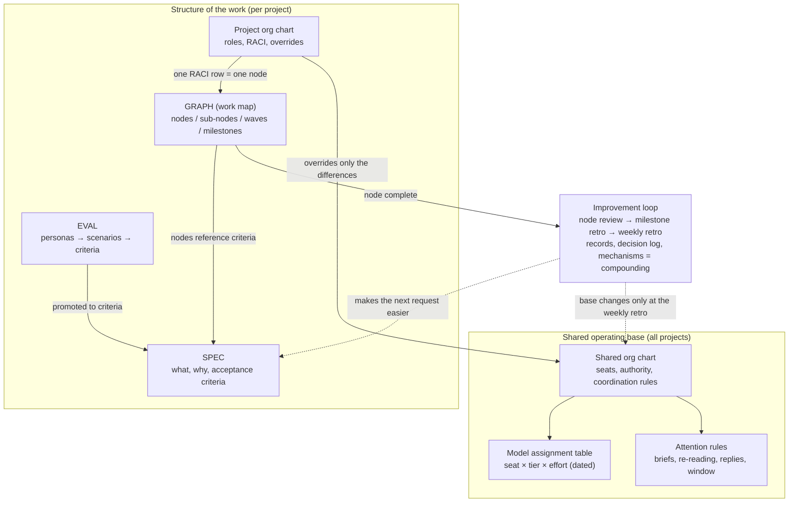
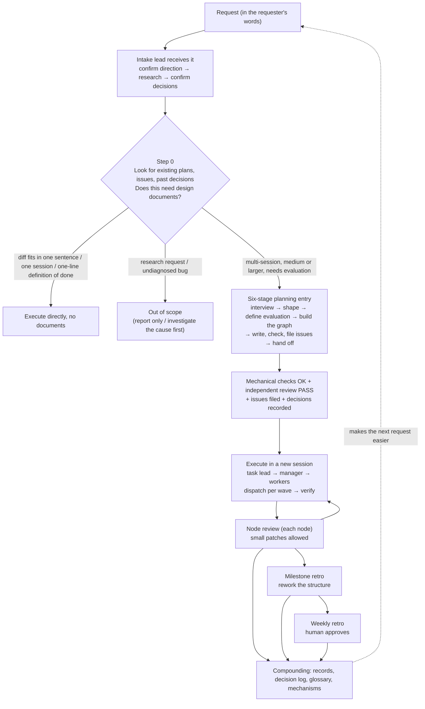
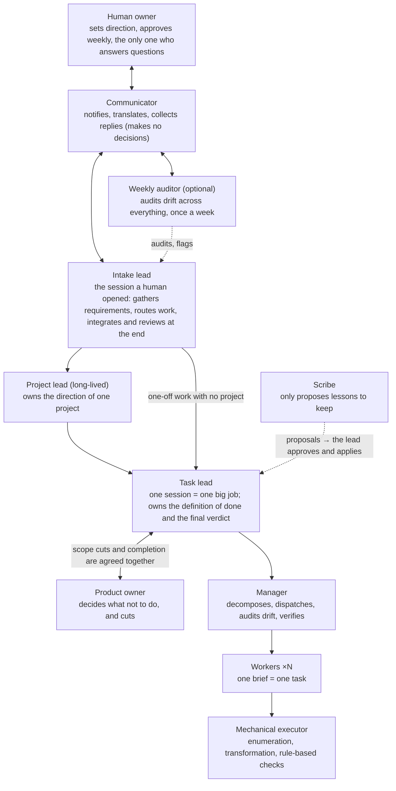
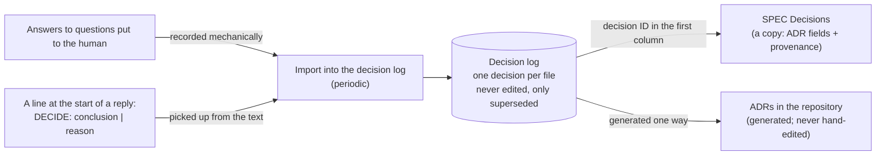
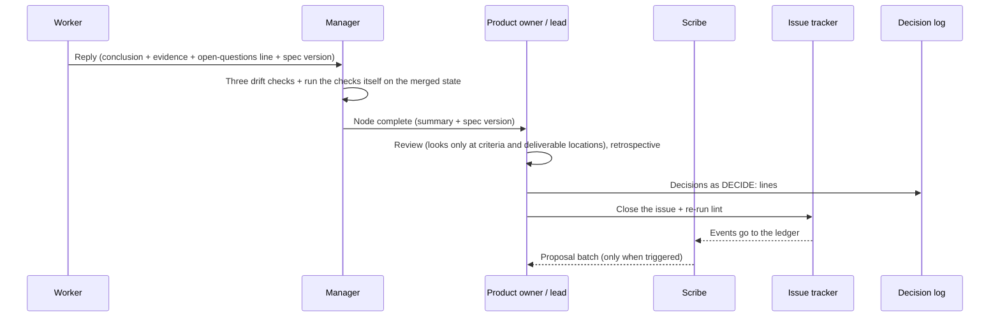

# Graph Compound Engineering — A Handbook for Running Work Through an Organization of AI Agents

English | [日本語](HANDBOOK.ja.md)

> **What this is**: a working method for handing multi-day, multi-person work to an organization of AI agents (language models that carry out tasks on their own). You turn a request into three design documents, run it with agents placed in "seats" sized by how much judgment each seat carries, and use reviews at each checkpoint so that every piece of work makes the next one easier.
> **Who it is for**: practitioners who know the basics of building with agents but have never seen the setup this method came from — developers who want to delegate multi-day work to agents, team leads, and anyone curious about running agents as a team. No specific product names or file locations appear here. The focus is on the ideas that hold in any environment, and on *why* each rule exists.
> **Read these three first**: §1 (the problem) → §2 (the big picture) → §13 (a minimal setup). Stuck on a term? See the §15 glossary, or use the question index in §0.
> **As of**: the design as of 2026-11. The "internal FAQ bot" project used as an example is **fictional** (§5).
> **Author / license**: Kazuaand. Text licensed under CC BY 4.0.

---

## 0. How to read this document

- Every section opens with a **bold conclusion** (what it is for and what to do), followed by details. If you are short on time, reading just the bold conclusions gives you the whole argument.
- Terms that are specific to this method (seat, the three documents, return conditions, and so on) are defined where they first appear and collected in §15.
- Models are described by **tier**, not by name. **Top tier** = the smartest, most expensive model, used for judgment. **Upper tier** = for management and hard problems. **Mid tier** = the workhorse for execution. **Light tier** = for mechanical work. Model names and generations change every few months, so the document only describes roles; which model fills which role lives in a separate, dated table (§11).
- "Top" and "upper" are reserved for model tiers. For positions in the organization (§6), this handbook says **higher seat / lower seat**.
- A **session** is one continuous conversation with an agent, from start to finish. The **window** is how much conversation and material a model can hold at once (its context window). It is finite, so what goes into it has to be designed (§7).

**Question index**

| If you want to know… | Read |
|---|---|
| What problem this solves | §1 |
| What each of the three documents holds, and why there are three | §4.1 |
| What a "seat" is and how it differs from a model | §6 |
| What "separate the maker from the judge" means | §7.4 |
| When to ask a human and when to keep going | §8.1 |
| When to stop and hand work back up (with one table of thresholds) | §8.2 |
| How the improvement loop works | §8.4 |
| Where to start in your own setup | §13 |

---

## 1. What problem does this solve?

**Conclusion**: When you hand a sizable job to agents, four things go wrong: (1) the work drifts away from its purpose, (2) "done!" is accepted on the agent's own say-so, (3) nobody can tell how far along things are, and (4) the human ends up buried in small checks, so nothing actually gets easier. This method prevents them by **fixing in documents what is done, in what order, and by whom; separating the one who makes from the one who judges; and turning lessons from each review into mechanisms**. The aim is to narrow human involvement to setting direction and approving changes once a week. The accumulated lessons — a decision log that keeps the reasons, checks that stop failures that have happened twice, a shared glossary — make the next request faster to scope and faster to verify (§8.5, §9).

The method is built as answers to five questions:

| Question | Answered by |
|---|---|
| What are we doing (why, and what counts as done)? | The specification (SPEC) |
| In what order (and what depends on what)? | The work map (GRAPH) |
| Who does it (who is accountable, how do they coordinate)? | The org chart (ORG CHART) and the seat ladder |
| What counts as finished? | Acceptance criteria and evaluation (EVAL) |
| When do we revisit the plan? | The three-level improvement loop (§8.4) |
| When do we ask a human? | The three-way decision rule and the return conditions (§8.1, §8.2) |

The name **GCE** stands for *graph compound engineering*. It takes compound engineering — the idea, popularized by Every in 2025, that each unit of work should make the next one easier — and adds a map of the dependencies between pieces of work, the **work graph**. "Compound" here means compounding returns on what you learn. It is unrelated to "compound AI systems," where "compound" means assembling components.

---

## 2. The big picture — two parts: the structure of the work, and the standing organization

**Conclusion**: The method has two parts. The **structure of the work** is written per project: what, in what order, by which roles. The **standing organization** is shared by every project: which seats exist, which model tier sits in each, and how each seat's attention is protected. The two connect because each project's org chart points at seats in the standing organization.

### 2.1 Three layers

If you think of it as a human team, three layers fit the whole thing on one page:

- **(A) The shared operating base** — the house rules and the equipment. Independent of any project: the seat ladder, which model tier goes where, the attention rules, how to delegate, how to verify. These are seats defined by function, not people. They change only at the weekly review, with a human present.
- **(B) Roles** — the specialist responsibilities a given project needs (a quality decider, a product owner, and so on). They differ from project to project and are written down in the three documents.
- **(C) Mapping roles to seats** — once you name a role, the base assigns a default seat and model tier according to how much judgment the role carries. Nobody has to decide each time that "this role needs the smartest model."

### 2.2 Why split it in two?

- "What we are doing" and "who does it, and how" change at different speeds. The work is different for every project; the way seats are divided and attention is protected can be reused again and again. Mix them, and finishing one project means rewriting your organizational rules.
- Many "graph" approaches in the industry fold the flow of work and the messages between agents into a single execution graph. This method decides up front that **the nodes of the work graph are pieces of work, not agents**. Agents (seats) live in the org chart.

---

## 3. One full cycle — from request to compounding

**Conclusion**: When a request arrives, first look for an existing plan or past decision, then judge whether the job is big enough to need design documents. If it is, write the three documents and the evaluation in one session, pass them through mechanical checks and an independent review, and then have a *different* session execute them. During execution, review each node as it completes, rework the structure at each milestone, and hold a weekly review with a human.

What happens at each step:

1. **The intake lead receives the request.** The agent in the session a human opened acts as the "intake lead" and does not implement anything itself. It first confirms the purpose, scope, success criteria and any blind spots, then researches (handing heavy reading to other agents), and finally asks the human — as a multiple-choice question with evidence, options and a recommendation — only about decisions that the research made newly necessary. If the purpose and scope are already clear from the request, it skips the questions and leaves one line explaining why.
2. **Step 0 — look for what already exists, and decide whether documents are needed.** Search first for plans, tracker issues and past decisions on the same subject. If they exist, resume them or append changes to the existing spec instead of starting fresh. Small jobs — the change fits in one sentence, it finishes in one session, and the definition of done is one line — run directly without the three documents. Research requests and undiagnosed bugs are outside this entry point (find the cause first).
3. **The six-stage planning entry (kickoff).** One session writes the three documents, the evaluation and the overview note (§4.2). This entry point never runs automatically; use it only when called explicitly.
4. **Hand-off and execution.** Commit the documents to version control, then paste "execute this work map" into a **separate, fresh session**. This keeps the memory of the planning conversation out of execution. On the execution side, a task lead oversees all nodes and assigns a manager per node; the manager sends briefs to workers one parallel batch (wave) at a time and verifies what comes back itself.
5. **Node review.** When a node completes, a seat other than the one that built it runs the acceptance criteria, writes a short retrospective and updates the status (§8.4).
6. **Milestone retro.** At a checkpoint chosen during planning, revisit the structure itself: the spec, the map and the org chart.
7. **Weekly retro.** Once a week a human joins as approver, settles the accumulated change proposals and goes through the list of undetermined points.
8. **Compounding.** Lessons from the improvement loop are promoted step by step: record → mechanism → structural agenda item (§8.5). Decisions go into the decision log; terms go into the glossary.

---

## 4. The three documents, the evaluation and the overview note — what each holds, and why they are separate

**Conclusion**: The **SPEC** says what, why, and what counts as done. The **GRAPH** (work map) says what, and in what order. The **ORG CHART** says who is accountable and how they coordinate. Together these are "the three documents." The **EVAL** is a subordinate document describing how the SPEC's acceptance criteria will be observed, and the **overview note** is a one-page summary that sits outside the three. They are separate because each changes at a different speed and each has a different set of people allowed to change it.

### 4.1 What each document answers, and who may change it

| Document | Answers | Main fields | Who may change it |
|---|---|---|---|
| **SPEC** | What, why, what counts as done | Size (XS / S / M / L) + purpose / terms and boundaries / open questions / acceptance criteria / out-of-scope items / decisions / Deviations / Undetermined | Purpose, acceptance criteria and out-of-scope items: higher seats and the human only. Lower seats may only update question status and append to Deviations |
| **GRAPH** (work map) | What, in what order | Nodes (outcome / criteria referenced / dependencies / stakes / milestone / status), sub-nodes, waves, milestones | The product owner creates and trims it. The status column follows the issue tracker |
| **ORG CHART** | Who is accountable, how they coordinate | Seats / seat layout and reporting lines / decision rights (RACI) / hand-offs and escalation / change control | The shared part changes only via the weekly retro. The project part holds only overrides and project-specific RACI |
| **EVAL** | How the acceptance criteria are observed | Personas → scenarios (Given / When / Then) → promotion to criteria → location of automated tests; judging rules | The quality decider (not the seat that built it) accepts or rejects |
| **Overview note** | The whole picture on one page | One-sentence purpose, reading order, where the key nodes and milestones sit, what was cut | The product owner updates it at each milestone |

**Why three documents?**

- **Separating "what" from "who" is standard project management** (work breakdown plus dependencies = what; a RACI matrix = who × what). Put them on one sheet and every change to how the work is divided breaks how responsibility is written. Keep them separate, connect them row by row through node IDs, and you can fix one without touching the other.
- **Different people may change them.** If only higher seats can change the purpose and the definition of done, and execution can only append, you prevent a common regression: someone mid-execution "fixing" things by adding criteria, which lowers quality.
- The links between documents (does every criterion ID a node references actually exist in the SPEC? does every RACI row have exactly one A?) are checked by a **mechanical lint** (an automatic format-and-link check). Lint only looks for broken IDs and missing required fields; whether the content is good is left to independent review.

### 4.2 The six-stage planning entry

**Before starting**: ahead of stage 1, ask how a top expert would approach this job (which primary sources they would read, which methods they would actually use, and which outside check would show the result is right), what the requester is really after, and whether the request is over- or under-specified. Take in only what makes the work better without making it bigger — but always put **one outside check, made by someone other than the maker,** into the definition of done.

| Stage | Purpose | Output |
|---|---|---|
| 1 Interview | Before researching, flush out the questions whose answers change the shape of the deliverable, and the unknowns nobody has noticed yet. Decide the size | Draft purpose, size, open questions, provisional undetermined items, research notes |
| 2 Shape | Resolve the forks and finalize the SPEC. Always ask the strategic DDD questions: terms, boundaries, core domain, sequence of events. The only place where direction-level forks go to the human | Every field of the SPEC |
| 3 Define evaluation | Make the acceptance criteria observable (write criteria from behavior, then turn them into tests) | EVAL + promotion to criteria |
| 4 Build the graph | Decide the top-level nodes first, then cut sub-nodes, dependencies, milestones and RACI | GRAPH + project org chart |
| 5 Write, check, file | Lint (structure) → independent review → file issues in the tracker → lint (complete) → record decisions | Lint OK, review PASS, issue IDs |
| 6 Hand off | Produce a launch prompt that starts execution when pasted. Never starts on its own | Launch prompt (with every referenced path confirmed to exist) |

- **"Define evaluation" always comes before "build the graph."** The node that builds the evaluation goes first in the map, and implementation nodes depend on it. Nothing gets built before "what good looks like" is settled.
- When the work touches an area the model does not know (internal policies, a brand-new API), put a **source-material node** — one that gathers and summarizes the material — ahead of the evaluation node.
- Scale the weight by size. Small jobs (S / XS) need only terms and boundaries; medium and larger (M / L) also require core domain and sequence of events.

### 4.3 Inside the SPEC

- **Terms and boundaries (domain)**: a glossary (correct term / definition / old names / unresolved), the boundaries of responsibility, what the core value of the work is (core domain), and the sequence of events. The glossary is the backbone: in the map and the evaluation, glossary terms appear in bold, and lint warns about terms that are not in the glossary.
- **Acceptance criteria**: prefer the form "run this command and you should see this." An automated judge may not be able to call tools, so write criteria whose results end up in the run transcript.
- **Decisions**: one line per decision, in ADR form (context / decision / consequences / status), plus **provenance**. There are two kinds: **settled** — a human weighed the trade-offs and chose; and **directive** — the lead decided (a human can overturn it at any time). An agent's guess is never recorded as a decision.
- **Deviations**: a field where deviations and changes made during execution are appended without rewriting the body. Status goes "staged" → "accepted / rejected" at the weekly retro.
- **Undetermined**: see §8.3.

### 4.4 Inside the work map

- **Two levels.** A top-level **node** is a piece of work a person recognizes as one outcome (one epic in the tracker, the unit of review). A **sub-node** is that node cut into pieces an AI can carry in one go (one task in the tracker). A person can understand the whole by looking only at the top level.
- **Dependencies are kept at the sub-node level.**
- **Stakes** is a required field on every node: `proto` (a prototype you can redo) or `prod` (irreversible, or visible to the outside world).
- A **wave** is a batch of sub-nodes run at the same time. Sub-nodes in the same wave never write to the same file (lockfiles and generated files included). The manager verifies at each wave boundary.
- A **milestone** is a checkpoint chosen at planning time: "this is where we want to revisit the approach." It is not an external deadline.
- **Never make an agent or a role a node.** Nodes are work; seats belong in the org chart.

### 4.5 Inside the org chart

- **Two levels**: a shared org chart for all projects + a per-project diff (overrides and project-specific RACI only). Checks run against the two merged.
- **Five chapters**: seats / seat layout, reporting lines and channels / decision rights (RACI) / hand-offs and escalation / change control.
- **Never put model names in the org chart.** Write only seat names and a reference to the assignment table, so a model change does not mean rewriting the org chart.
- **RACI**: rows are nodes of the map; columns are seats. R = does the work, A = accountable, C = consulted, I = informed. **Each row has exactly one A** (which may be an agent seat) and at least one R. **The human owner column is required and may not be empty.** A or R means human-in-the-loop, C means human-on-the-loop, I means human-out-of-the-loop. The human does not have to be the A. Moving the human from A/R down to C/I, step by step, is how you measure how much you can now trust the AI with (at most one step per week).
- **Mainline nodes** are `prod` nodes and nodes leading into a milestone gate. Changing the **rules** of these nodes (degree of autonomy, gates, grading criteria, return conditions) keeps the human as A even if the human has been moved down for execution. Running the work and setting the rules of the work are kept apart; only the former is delegated.
- **The parallel-write contract (wave contract)**: ① a wave starts from a state committed to version control (the brief names the starting commit; never dispatch from uncommitted work) ② each sub-node owns the files it writes ③ a worker's version-control rights end at committing to its own working branch ④ merging to the main line, publishing, rewriting history and deleting workspaces are for the manager and above ⑤ verification is done by the manager, not the worker who built it.

### 4.6 Inside the evaluation

- Each **persona** carries one evidence type: `evidence` (based on real documents or records), `research-grounded` (fictional but based on research) or `free-synthetic` (no basis; must be labeled). The first two are equally valid.
- Whether a persona is adopted (the **curator decision**) is made by the quality decider, not by the seat that wrote it. Only scenarios built from adopted personas can be promoted to acceptance criteria.
- **Use personas for what they are good for.** They are fine for generating scenarios; do not use them to forecast demand or proportions.
- **Judging rules**: every verdict quotes the line of evidence it rests on, and confidence is one of high / medium / low (high requires a quote). The judge is a different seat from the maker and runs in a different context (no shared conversation memory).

---

## 5. A worked example — an internal FAQ bot (fictional)

**This example is fictional.** It is not a real company or project. It is here to show concretely how the three documents fill in and how one cycle runs.

**Request**: "General Affairs gets too many questions. Build a bot that answers employees in chat, based on our internal policies."

### 5.1 Step 0 and size

- Look for existing plans or past decisions → nothing similar.
- The change does not fit in one sentence, spans several sessions, and needs its correctness evaluated → **size M**. Use the planning entry.

### 5.2 How the three documents fill in (excerpts)

**SPEC**

- Purpose: when an employee asks a General Affairs question in chat, answer by quoting the relevant policy, and hand the question to a staff member when it cannot be answered.
- Glossary (excerpt):

| Term | Definition | Old name |
|---|---|---|
| Policy | The original text of an internal rule maintained by General Affairs | Manual |
| Answer | A bot reply that contains at least one quotation from a policy | FAQ |
| Hand-off | Passing a question the bot cannot answer to a staff member | Escalation |

- Boundaries: policy ingestion / answer generation / hand-off to staff.
- Core domain: **accurate answers with quotations**. Spend the smart models and the evaluation effort here; use an off-the-shelf chat front end.
- Acceptance criteria (excerpt): AC-01 "Running the evaluation question set shows a quoted-correct-answer rate at or above the target." AC-02 "For questions not covered by any policy, the bot does not answer and hands off instead."
- Out of scope: no answers about individual salary or performance-review cases.
- Undetermined: OPEN-01 "What should the target accuracy be?" Provisional handling = 80% / confirmed when = the head of General Affairs sets it after seeing results on 20 trial questions / timing = during implementation.
- Decision: "Every answer must quote a policy." Provenance = settled (the requester compared it with a no-quote option and chose this).

**EVAL**

- Personas: P-01 an employee one month into the job (evidence = past inquiry logs); P-02 a General Affairs staff member (evidence = interviews with staff). Both adopted by the quality decider.
- Scenario: Given an employee one month into the job / When they ask "What is the deadline for submitting travel expenses?" / Then the bot quotes the relevant clause and states the deadline → promoted to AC-01.

**GRAPH**

| Node | Outcome | Depends on | Stakes | Milestone |
|---|---|---|---|---|
| N1 | Evaluation question set and grading harness (the evaluation node) | — | proto | M1 |
| N2 | Policy ingestion (the source-material node) | — | proto | M1 |
| N3 | Answer generation (three sub-nodes: retrieval, answer text, quote formatting) | N1, N2 | proto | M1 |
| N4 | Hand-off to staff | N3 | proto | M1 |
| N5 | Internal release | N4 | **prod** | M1 gate |

Wave 1 = the sub-nodes of N1 and N2 in parallel; wave 2 = the three sub-nodes of N3 in parallel (each writing different files); and so on.

**ORG CHART (project diff)**

- Add one role: "quality decider" (accepts or rejects grading results, gives no scores, and is a different seat from the maker).
- RACI: for N5 (internal release), A = the human owner. For N1–N4, A = the task lead, and the human column is C (consulted).

### 5.3 One cycle in motion

1. **Execute**: the manager sends briefs to the two wave-1 workers.
2. **Verify**: a worker reports "all tests pass." The manager does not take that on trust; it merges everyone's work and runs the grading harness itself → three questions fail → a revision brief goes back to the same worker.
3. **Return condition**: answer generation misses the bar three times in a row → execution stops, and a record goes up: "Question: the ingested policies may be an old version / Provisional handling: re-ingest the latest version / Confirmed when: General Affairs confirms the latest version."
4. **Node review**: when N3 finishes, the product owner — who did not build it — runs AC-01. The retrospective records, for the first time, that "policy tables break during ingestion."
5. **It happens a second time** → instead of adding a written warning, add a test that detects broken tables at ingestion (a mechanism).
6. **Milestone retro (M1)**: the team decides that making hand-off its own node was over-splitting, and fixes the map's structure.
7. **Weekly retro**: the human approves the accumulated changes and, looking at the trial results, fixes the target for OPEN-01.

---

## 6. The seat ladder — what a "seat" is, and how it differs from a model

**Conclusion**: A **seat** is a position that carries responsibility for part of the work. Seats are functional positions divided by *how heavy the judgment is* and *what the occupant pays attention to*; a seat is neither a model nor a person, and the same model may sit in different seats. Higher seats make heavier judgments over a wider scope and get smarter, more expensive models. Lower seats have narrow scopes and get cheaper models or deterministic scripts. Instructions flow down as files; what flows back up is a short summary and pointers to the evidence.

### 6.1 The ladder

### 6.2 The seats

| Seat | Pays attention to | Model tier | Authority and limits | Returns upward |
|---|---|---|---|---|
| **Human owner** | Direction; weekly approval | — | Approves changes that cross criteria or boundaries. A for the rules of mainline nodes. The only person who receives questions | — |
| **Weekly auditor** (optional) | Drift between "what we decided" and "what is actually happening," across everything | Upper + mid (running the audit), top tier for dialogue | Mostly audits and flags. Authority is written separately per mode: audit / coordinate / clean up | A list of questions: "this is what's happening — is that right?" |
| **Intake lead** | The human's intent | Top (high effort) | Does not implement. Anything with two or more tasks, or medium size and up, always goes through lead → manager | Reports to the human |
| **Project lead** | The project's direction | Top (high effort) | Does not execute. Cannot ask the human directly | Integration reviews and drift audits |
| **Task lead** | The session's spec and definition of done | Top (medium effort) | Holds the spec, sets up the manager. Accountable (A) for the final verdict | Summary + open-questions line + spec version |
| **Product owner** | What not to do | No seat of its own (a role the lead's session also plays) | May cut the SPEC and the map; chairs the milestone retro | — |
| **Manager** | The gap between workers' output and the spec | Upper (maximum effort) | Does not implement. Never changes purpose, criteria or out-of-scope items. Never treats a worker's self-assessment as done; runs the checks itself | Conclusion → evidence → risks → next → unverified + open-questions line + spec version |
| **Worker** | The single task in its brief | Mid tier by default. Upper tier after two failures, or when security, correctness or design judgment is involved | Writes only to the output location its brief names. Cannot ask the human directly | One-line conclusion + evidence + open-questions line + spec version |
| **Mechanical executor** | Mechanical accuracy | Light tier; use a deterministic script first if one exists | Makes no judgment calls; returns ambiguity as-is | Output location + one-line count |
| **Scribe** | Candidate lessons | Mid tier (read-only) | Writes nothing. The lead approves and applies | A batch of proposals |
| **Communicator** | Connecting the human and the seats | — | Makes no decisions | — |
| **Role (project-specific)** | e.g. quality decider | Added per project | A different instance from the maker. Accepts or rejects, but gives no scores | A record of verdicts |

- **Five roles are required**: human owner / task lead / product owner / manager / worker (the product owner has no seat of its own; the task lead's session plays it). Add the rest as the job grows. For small jobs, the intake lead sets up a task lead directly and there is no project lead.
- **Use the smallest structure that fits.** Seats describe how responsibility and attention are divided; they are not a rule that every level must be filled by its own agent every time. The manager's responsibilities (decompose, dispatch, verify) must always belong to someone, but whether that is a dedicated agent or the lead doing double duty depends on the size of the job. Which model sits in a seat is likewise chosen at dispatch time, by fitness, available quota and cost.
- **One seat, one name.** Never use the same word for two seats. When seat names wobble between documents, someone will always get confused about who does what.

### 6.3 What differs between higher and lower seats — four principles

1. **Spend intelligence on judgment, keep execution cheap.** Use the expensive top-tier model only for judgment (direction, drift audits, the final synthesis); leave execution to the mid tier and below. Workers (the seats that make) only need to get to about 80%; the manager and judges (the seats that check) bring it up to finished quality. Which concrete model fills each tier lives in a dated assignment table (§11).
2. **Never make the manager the highest seat.** Always put a judging lead above the manager. A manager spends its attention on hands-on verification, so a different seat is needed to watch the overall direction. Keep this shape even for thin jobs. The only exception is a one-off — one task, complete inputs, a small deliverable, and a human checking right away — where a lead may hand the task straight to a worker.
3. **Only the seat in the session a human opened (the intake lead) may ask the human directly.** Every other seat, when it needs a decision, does not fill the gap with a guess; it returns a **blocked-record** upward containing "question / provisional handling / condition for settling it" (or question / background / options / recommendation). Questions climb the ladder: whatever can be settled from the human's past answers, existing rules, the SPEC, an expert agent or a bit of research, the higher seat decides. Only matters involving money, outbound communication, production, direction or a risk of drift go to the human, and the intake lead bundles them.
4. **Put one cap on parallelism for the whole system.** Cap the number of agents running at once across the whole machine, not per seat (a number a human can still follow; pick a starting value and tune it). Spreading wider than that lets verification and integration fall behind, and quality drops.

### 6.4 When things get stuck (escalation)

- A worker **fails twice** at the same task → swap in a worker of a higher tier, and allow it to call a top-tier model as a **read-only advisor** (as a rule of thumb: at most two consultations per task, short answers, and every consultation recorded). The advisor runs in its own window, so the lead's window stays clean.
- Still failing → the manager investigates the root cause → returns a blocked-record to the lead.
- **Thresholds may differ by subject** (two failures for a worker, three consecutive failures for a check, two review round-trips before going to the human), but unless you put "which threshold sends what to whom" on **one table**, every document will route things differently. This handbook's table is at the end of §8.2.

### 6.5 Seating external agents

- Coding agents or CLIs from other vendors can sit in a worker seat too. Use them **only when explicitly specified**, never as the default route.
- For an agent running in another environment, **enforce only the contract of the seat it occupies** (the return format, the definition of done, the budget, no asking the human directly), and let it handle its own internal delegation. Enforcing the minimum makes you robust to differences between environments.
- Briefs for external agents spell out the steps. The lead makes the design decisions before handing over, and passes its conclusions as hypotheses, not facts.

---

## 7. Attention engineering — protecting each seat's attention

**Conclusion**: The **window** of a higher seat (its context: how much conversation and material the model can hold at once) is finite — a zero-sum resource where anything you add pushes something else out. So keep it free for judgment. Concretely: ① give each seat one focus ② hand over work as files ③ send only short summaries and evidence pointers upward ④ separate the maker from the judge ⑤ re-read the spec at fixed moments.

### 7.1 Briefs are files

- Before writing a brief, ask how a top expert would approach that task, and put one outside check into its definition of done. If a human will receive the deliverable, name the location of that reader's persona in the brief.
- Hand work over as **a single file (a brief)**, not as chat text; the higher seat keeps only the file's location and version. Do not copy the SPEC's contents into it — **pass locations and diffs, not summaries**. The receiver can read the originals itself, which prevents the losses and drift that summaries introduce. As the saying goes, a strong model with a thin brief loses to a weaker model with full context.
- **The nine fields of a brief**: purpose / open questions / one task / input locations / definition of done (DoD) / budget (tokens and time) / stop point / output location / prohibitions. End with the spec version and have the reply echo it back. These nine fields work just as well for briefing contractors or colleagues. The stop point marks where one task ends; it is not the same thing as the return conditions in §8.2 (the conditions for handing work back up).
- Briefs for highly autonomous upper-tier models must include a budget, a definition of done and a stop point. Stronger models are more likely to over-expand the work or keep running for hours. Spell out how to stop, too: "When the checks pass, report and stop. Do not start additional reviews unless asked."
- Any brief that hands over decisions includes a fixed sentence: "If you find evidence that a settled decision no longer holds, do not stay silent — report it."

### 7.2 Re-read the spec at four fixed moments

① Before dispatching work ② when verifying what came back ③ right after resuming, compressing context or taking over (the first action is to read the spec) ④ before reporting upward.

Each time a reply comes in, the manager applies the **three drift checks**: Does it hit the definition of done? Did it step outside its scope? Did it invent assumptions that are not in the spec? The outcome is one of: fix and accept / re-brief / escalate. Higher seats read the summary and the spec only at milestones and before the final report.

### 7.3 A version fingerprint shows whether work was built against an old spec

Each time the spec changes, bump its version and use the first few characters of the file's hash (a fingerprint computed from its content) as the version mark. Require the mark in both the brief and the reply; the receiver compares it as a string with the current version and sends the work back if it differs. This proves only that the spec was "not stale," not that it was read. Pick one form for the mark (how many characters; version number or hash) and stick to it. If you revise the spec but forget to bump the version, the mechanism quietly stops working.

### 7.4 Separate the maker from the judge (evaluator ≠ generator)

**What**: the seat that produced the work (the generator) never gives the final verdict on it. A different seat (the evaluator) judges it, in a different window. Higher seats always stand on the judging side.

**Why it matters**:

- **Self-reports are not evidence.** Long-running agents tend to report "improved it" or "everything passes," yet measurement sometimes shows no improvement, or a regression. The maker cannot see what it missed, because it never looked there.
- **Two viewpoints in the same context are one witness, not two.** Asking the same conversation to "now look at it as a reviewer" carries over the maker's assumptions. So judge in a separate window — a separate instance that does not inherit the conversation. Using the same model is fine; the same window, or a copy that inherited the conversation, is not.
- **Do not show the judge how the work was made.** Give the judge only the spec and the location of the deliverable. Showing the maker's explanations or reasoning anchors the judge to them.

**Operating rules**:

- Judge in two stages: ① the manager evaluates the workers' output ② a fresh judge with no context evaluates the manager's summary.
- At most two review round-trips; the third goes to the human. The default is "fix and accept." Adding criteria during a review counts as a scope change.
- Choose the judge by the nature of what is being judged, and keep that choice on one table.

| What is being judged | How to judge it |
|---|---|
| Right or wrong is settled by reproducible evidence (tests, official documentation, deterministic tools) / a very small job | Skip the judge; record the result of the evidence in one line |
| A plan with settled scope / an internal deliverable | One separate judge instance with no context |
| Something readable on its own (a code diff, a general design, logical consistency) | A model from another vendor |
| An exploratory plan whose premises are still moving | Run both of the above in parallel (both advisory; the lead rules) |
| A review that needs a meta-level view | A top-tier judge, only when the human explicitly asks |

### 7.5 What goes into the window, and what stays out

| Let in | Keep out |
|---|---|
| The requester's original words / the spec's location and version / decisions and their reasons / short summaries / unresolved forks / one line of environment essentials | Full text of long files / diffs / logs and fetched content / lower seats' run transcripts / model manuals / watching a screen while waiting / exploration in progress |

- When waiting, don't keep watching a screen. Receive only state-change notifications, and go read a status file yourself when you need the situation.
- When work drags on, consolidate into a status file and hand over to a new seat. Don't bring a long-idle session back into the same conversation; start fresh with the spec's location, the status file and the requester's original words (while it sat idle the cache expired, so going back is neither cheaper nor faster). The thresholds depend on the environment, so write them down in exactly one place.

### 7.6 The shape of a reply, and the open-questions line

- Send only a summary upward (roughly 1–2 thousand tokens). Order: **one-line conclusion → evidence (file and line) → risks and trade-offs → next step → what is still unverified**. Long summaries, pasted logs and a bare "done" get sent back.
- End with a one-line **open-questions list**, e.g. `Open: Q1=closed(<where the evidence is>) Q2=open(<why>)`. This keeps unanswered questions from being buried under activity reports. A missing ID is treated as a sign of drift, and the reply goes back.

### 7.7 Write the brief for the kind of reader receiving it

Make the level of detail inversely proportional to the model's tier. The higher the tier, the more you give only purpose, constraints and definition of done; spelling out steps actually makes them perform worse.

| Receiver | Give | Avoid |
|---|---|---|
| Top tier (judgment, verdicts) | 1–2 sentences of purpose + why + a one-line verifiable definition of done + one sentence on when to stop + out-of-scope items | Step lists, forced re-verification, instructions to write out reasoning |
| Upper tier (management, hard problems) | The complete spec in one message (purpose + "done means…" + when to stop and ask). Inputs gathered up front | Excessive verification instructions ("verify at the end," "double-check"), adding rules midway |
| Mid tier (execution) | Everything in the first message: the task, why, constraints, scope, concrete thresholds. Done = real checks (tests, builds, type checks) | "Be conservative," "only the important ones" (more misses) |
| Light tier (mechanical) | Steps, files to reference, starting point + a machine-checkable definition of done | Design or visual judgment, vague purposes (have it return ambiguity as-is) |
| External coding agents | Down to the steps: patterns to follow, starting point, machine-checkable done, areas not to touch. Split into chunks of a few hours at most | Handing over design wholesale; presenting the lead's conclusions as facts |

### 7.8 Separate the screens humans watch from the ones they don't

- When you start another session, put only the seats **worth a human's conversation or review** (the intake lead, the leads) on screens the human can see, and run the rest (everything under the manager, mechanical work, an external agent's internals) where the human does not look. The criterion is whether human involvement adds value, not the model tier.
- If a session in the hidden area needs a human after its parent is gone, it **promotes itself to a visible screen**. It never just sits there silently.

---

## 8. Operating rules

**Conclusion**: When in doubt, use the three-way decision rule. Register anything you cannot decide as Undetermined and keep moving. If any of the five return conditions occurs, stop implementing and hand the work back to the higher seat. Run retrospectives as a three-level improvement loop, and only settle changes to shared rules and templates at the weekly retro.

### 8.1 Three ways to handle a decision (the three-way decision rule)

| Handling | When | What to do |
|---|---|---|
| **Ask a human** | A decision outside the agreed purpose, scope or authority / an important fork that newly needs a human's choice (including boundaries, whether to stop, anything irreversible or high-impact such as a `prod` node) | Ask the human owner, with evidence, options and a recommendation. Only the seat in a session a human opened can ask. If only the shape of the deliverable changes, first check whether it is still inside the agreed authority |
| **Register an assumption and proceed** | Knowable by research, but not verifiable right now / reversible and low-impact | Add one line to the SPEC's Undetermined field and proceed with the provisional handling |
| **Proceed** | Settled by looking up facts / reversible / contained within the SPEC | Just proceed |

- Whether to ask depends **not on the size of the job but on whether there is an open issue** (a blind spot, a contradiction, an unknown). Ask about a small job if it has one; don't ask about a big job if it has none.
- Forks that come up mid-work are registered as Undetermined, and you ask about them **together, at the end of a stretch of work**, so the human is not pulled back again and again.
- When no human is around, decisions beyond the agreed authority and important choices are never settled by assumption. Turn them into a blocked-record (question / options / recommendation / work that depends on it / condition for settling it), return it to the higher seat, and keep going with work that does not depend on the answer. Only small, reversible unknowns get registered as Undetermined so you can proceed.

### 8.2 When to stop and hand work back up (the five return conditions)

If any of these occurs, stop implementing, write a blocked-record and return it to the higher seat. They apply at all times, during planning and execution alike. If you are adopting them for the first time, start with 1–4 and add 5 once you run a decision log.

1. **Three consecutive check failures**: lint, independent review or an acceptance check failed three times in a row on the same target. If two fixes for the same check didn't work, don't keep patching blindly — name the premise both fixes relied on and test it before attempting a third.
2. **A decision outside the spec**: a decision is needed that none of the acceptance criteria, out-of-scope items or decisions covers.
3. **No progress on an unknown problem for a set time** (as a rule of thumb, 30 minutes).
4. **Scope exceeded**: the work needs to go beyond the node's scope (including writing to files it does not own).
5. **Evidence that a settled decision no longer holds.**

- **A reply without evidence is not a return condition.** When a lower seat's reply is not in the form "done + evidence (the output of the check it ran, or the location of the deliverable)," the verifier, the evaluation or lint stops it and has it fixed. Escalating problems a machine can check (a "done" with no evidence, an empty report) up the ladder or to the human spends human attention on the cheapest problems there are. Escalate to the human only for money, outbound communication, production, direction, and settled decisions that no longer hold.
- This method stops on these return conditions rather than on a spending cap ("stop when you've used this much"). In environments billed at a flat rate, "come back when you're stuck in a swamp" fits reality better than a budget figure.

**One table of thresholds and destinations** (the numbers are rules of thumb; set your own and keep them in this one table)

| What happened | Threshold | What next | Goes to |
|---|---|---|---|
| A worker fails at the same task | 2 times | Swap in a higher-tier worker and allow it to call a top-tier advisor | Manager decides |
| Still failing after raising the tier | — | The manager investigates the root cause and writes a blocked-record | Lead |
| The same check fails repeatedly on the same target | 3 in a row (test the premise after the 2nd) | Stop implementing, write a blocked-record | Higher seat |
| Review round-trips | 2 | The 3rd goes to the human | Human owner |
| No progress on an unknown problem | about 30 minutes | Stop implementing, write a blocked-record | Higher seat |
| Decision outside the spec / scope exceeded / evidence a settled decision no longer holds | once | Stop implementing, write a blocked-record | Higher seat (up to the human if it touches direction) |
| A reply has no evidence | once | The verifier sends it back to be fixed | Not escalated |

### 8.3 Register what is undetermined instead of hiding it

- A point that still cannot be decided after discussion is registered explicitly as "not yet decided," and settled in the course of the work. This is different from deciding nothing up front (which drifts immediately).
- Fields: question (phrased as a question) / **provisional handling** (required — if it is empty, it is not an undetermined item but a blocker to ask about first) / condition for settling it (who, looking at what, deciding when; "once we've discussed it" is not allowed) / when it gets settled (before starting / during implementation / after launch) / status / blocks the plan? (yes = don't build the map or hand off until it is settled; reserve yes for open items involving money, outbound communication, production or direction, and mark everything else no and proceed on the provisional handling).
- When an item is settled, don't delete the row: mark it settled, add what was decided and the date, and move the conclusion into Decisions.
- Even when the human answers "all the provisional choices are fine" in one go, nothing is settled until it is written back into each row and into the RACI.

### 8.4 Three levels of improvement loop

| Level | When | Who | What |
|---|---|---|---|
| **Node review** | When a node in the map completes | Product owner and task lead (not the seat that built it) | **Small patches are allowed.** Run the acceptance criteria and record failures. Don't settle structural rework here; log it instead |
| **Milestone retro** | When every node in a milestone is done | Product owner (chair) and the lead | **Rework the structure.** Revisit boundaries, splits, dependencies and seats in the SPEC, map and org chart. Anything that touches purpose or criteria goes to the weekly retro |
| **Weekly retro** | A fixed weekday each week + after an incident, a complaint, a model switch or detected drift | Prepared by the lead side, approved by the human | **Revisit the standards themselves.** Settle accumulated changes, go through Undetermined, decide which nodes can lower human involvement |

- **Why three levels**: AI leans toward patching the failure in front of it (bottom-up). Its window holds one defect at a time, its reward is local, and it has neither the authority nor the memory to cut across the whole. So you provide, separately, a seat with the whole picture and the authority to cut, memory that spans multiple defects, and a forum where cutting counts as progress.
- **Switch levels by where the cause lies, not by how often it happens.** A cause specific to that occasion (a special cause) gets a patch; a cause rooted in the system (a common cause) gets structural rework.
- Higher levels receive summaries from lower ones, but every summary must carry references to the original records or deliverables, and the higher level spot-checks them. Self-reports from lower seats are not grounds for trust.
- Whenever you propose adding a standing instruction, list an equal amount of instructions to remove in the same round. Instructions are a finite budget: the more you add, the less each one does.
- While the system is new, run the retro weekly; once it is stable, you may relax it to monthly (the human decides at a retro).

### 8.5 Promoting lessons (record → mechanism → structural agenda)

| Step | Condition | Handling |
|---|---|---|
| 1 Record | It happened for the first time | Log the lesson with a reference to the original record. Don't turn it into a rule |
| 2 Mechanism | The same failure happened twice | Don't add a written warning; stop it with a deterministic mechanism — a hook, lint or test |
| 3 Structural agenda | It recurred despite the mechanism / it spread to two or more areas / the same point came up twice in retros | Put it at the top of the milestone retro's agenda and consider reworking the three documents |

- **The bar for recording**: record only lessons that are reusable, whose reproduction conditions can be written down, and that have one source. "If deleting this record would still let the next person avoid the same failure just by reading the final deliverable, don't record it."
- **Don't lose unprocessed lessons**: don't report a node as complete until any unprocessed finding is written somewhere a human will see and that persists (a tracker issue or the body of a report).

### 8.6 When no human is present (human gates)

- Places where a human is involved = nodes where the human is A or R in the RACI + irreversible operations (deletion, outbound sends, charges, forced history rewrites). For each, decide whether it is critical and what happens when no human is around.
- The ladder: ① the parent seat can respond → escalate to the parent, which asks the human ② no human × not critical → proceed with the recommended option (the provisional handling of an Undetermined item), leaving a Deviation and a blocked-record ③ no human × critical → mark everything up to that point complete, produce one page with the material needed to decide, and stop.
- Every question to a human carries a recommendation, whether it is critical, and a default deadline (for example, two hours after asking). Once the deadline passes, a non-critical decision proceeds on the recommendation and is logged as a staged Deviation; a critical decision stays pending. Free, reversible investigation never waits for the answer.
- If a question sits unanswered for a long time and gets cancelled automatically, that is not approval. Silence, timeouts, absence and failed delivery never count as approval.
- When the human is on another screen, **sending the question as a file and receiving the answer as a file** works well. Write this route, and the role that relays answers on the human's behalf, into the seat table.

### 8.7 Change control

- Adding or replacing a seat, or changing authority or coordination rules, goes through this path: write it as a staged Deviation → the human approves at the weekly retro → rewrite the source of truth (the shared org chart, the model assignment table) and supersede the old decision in the decision log. Day-to-day changes are the product owner's call; human approval is only for new things and things that cross boundaries.
- Make it explicit that **procedural rules (the planning entry, templates, lint, review procedure, attention rules) go through the same path** as seat rules. If you write the path only for seat changes, procedural changes slip into the source of truth without approval.

---

## 9. Records and the loop

**Conclusion**: Give every kind of information exactly one home: the *why* of decisions in the decision log, work status and dependencies in the issue tracker, structure in the three documents, long-lived knowledge in a knowledge base, and reports for humans in a report location. The scribe only proposes what to promote; the lead does the writing.

### 9.1 How decisions flow — decision log → SPEC Decisions → ADR

- The source of truth for *why* is the **decision log**: one decision per file, never rewritten, updated only by a chain of newer decisions that supersede older ones. ADRs (the established format that records each decision's context, decision, consequences and status) are a subset; for long-lived code repositories they are generated one way from the decision log and never read back. That keeps a single source of truth.
- **There are two recording routes.** (a) Answers to questions put to the human are recorded mechanically: question, options and the choice. (b) Decisions made in conversation are written by the lead as a line at the start of its reply, `DECIDE: conclusion | reason`, which a later step picks up. Because (b) depends on the agent remembering to write it, add a step at session close that asks, "Is there a decision you forgot to record?"
- **Keep provenance.** The decision log must say whether a human decided or the lead decided (or ratified). If everything is recorded as "the human decided," later readers will mistake the lead's calls for human rulings.

### 9.2 The scribe

- Events (answers to questions, completed issues, node review reports, commits, decisions and lessons a human wrote down) are **appended** to a ledger by hooks.
- The scribe reads the ledger in batches and returns candidates for promotion as a "proposal batch." It writes nothing itself (read-only). Candidate types: memory / rule / knowledge base / issue / observe only / mechanism / structural agenda / not needed. Every rule candidate comes with an offsetting candidate for removal.
- Don't keep the scribe running; make it a background job triggered by events or thresholds. Only the judgment of what to keep goes to a cheap model; storage, search and expiry are deterministic.
- **Watch out**: if only "append to the ledger" is automated and nobody ever triggers "read in batches," the scribe never does any work yet gets described as "implemented." Check that the trigger is actually wired up.

### 9.3 Report per checkpoint

- Report to humans per node review or per issue, not per conversational turn or per session. One piece of work = one report page that gets overwritten; don't multiply screens.
- Write reports assuming "the reader remembers nothing." Lead with what the work is, where it stands now, and what the human genuinely needs to do (say "nothing" if nothing).

### 9.4 The issue tracker's role

- The issue tracker is the source of truth for work status and dependencies. Node = epic, sub-node = task. Dependencies pointing the wrong way invert everything in ways that are hard to notice, so after creating them, display the dependency tree and check the direction.
- Where things live: tracker = work, dependencies, resumption (moving information) / decision log = reasons for decisions (unchanging information) / knowledge base = long-lived knowledge / three documents = the source of truth for structure / reports = deliveries for humans.
- **Pick one source of truth for status.** As status gets written in more places — the map's status column, the tracker, the SPEC's criteria status, a progress note, review records — they all drift apart. Decide up front which is the source and which are copies, and either update the copies automatically or don't keep them.

### 9.5 Closing a session is not the same as reaching a checkpoint

Cleaning up when a session closes (recording, filing unfinished work, committing) and reaching a checkpoint in the plan (completing a node) are different events. Closing a session does not complete a node, and a node review does not start when a session ends. If you connect the two, make the connection explicit.

---

## 10. Rules enforced by machines, and rules kept in prose

**Conclusion**: Split rules into those a machine stops and those kept as written agreements (prose), and list honestly which is which. Let a machine block (deny) only what is misuse with high confidence; everything else gets a warning. The most dangerous thing is assuming "lint must be catching that" and skipping the check.

### 10.1 Levels of strength

| Strength | Meaning |
|---|---|
| **Deny** | Blocks the tool call or the commit |
| **Send back once** | A check at the end sends the work back one time |
| **Warn** | Only adds a caution |
| **Not wired** | The checking tool exists, but nothing calls it automatically |
| **Prose only** | No machine; only the written agreement |

### 10.2 Typical placements

| Rule | Typical strength |
|---|---|
| Don't put questions to the human while they're away | Deny (only while the "away" flag is set) |
| Don't wake a long-idle agent in the same conversation | Deny |
| Irreversible operations (deleting data, etc.) | Deny (with a narrowly defined target) |
| Don't assign an expensive top-tier model to a lower seat | Deny (with an explicit override available) |
| Don't start an external agent without explicit instruction | Deny |
| Required fields in a brief | Warn (roughly: does the field name appear) |
| Remaining context | Warn |
| A "done" report without evidence | The verifier, evaluation or lint stops it and has it fixed (not escalated to the human) |
| ID links and required fields across the three documents | Lint can fail it, but **if nothing calls lint automatically, it is no better than prose** |
| Return conditions, version checks, maker ≠ judge, re-reading moments, the three drift checks | Tend to end up as prose only |

- Add machines only after the "second occurrence" in the lesson-promotion ladder has actually happened. Adding them in advance multiplies machines that block correct work through false positives.
- In exchange, **never let the documents describe a machine as stronger than it really is**. If a document says "lint is required" but nothing runs it automatically, write down who runs it and when.

### 10.3 Fix only the boundaries

- When writing instructions, rules or an organization, hand over the purpose, constraints, definition of done and reasons, and leave the judgment and the method to whatever model is doing the work at the time.
- Hard-code only what would still need to be fixed even if the models got much smarter: irreversible operations (money, outbound communication, production, data loss), permissions, caps, and outside verification (a separate evaluator, deterministic grading, a human).
- Build procedures and extra mechanisms so they are easy to remove, treating each as "a hypothesis about a weakness of today's models." When a new model arrives, measure with evaluations and remove what is no longer needed. Keep procedures whose order is itself a requirement.
- Whenever you set a pass condition or a score, ask "how could this be met without actually doing the work?" and close that gap before you rely on it.

---

## 11. What stays the same when the tools change (ports and adapters)

**Conclusion**: Write the unchanging roles and contracts (**ports**) separately from the concrete, swappable tools (**adapters**). Seats, the fields of a brief, the shape of a reply and "maker ≠ judge" are ports. Which model sits where with how much effort, and which agent CLI runs it, are dated adapters.

| Port (stays the same) | Example adapters (swappable) |
|---|---|
| Intake lead, leads = judgment seats | Top-tier model × high / medium effort |
| Manager = decomposition and verification | Upper-tier model × maximum effort |
| Worker = one task | Mid-tier model by default; for hard problems an upper-tier model + a top-tier advisor / another vendor's coding agent (only when explicitly specified) |
| Mechanical executor | Light-tier model, or a deterministic script |
| Brief as a file / open-questions line / spec version | Checks when the agent CLI starts / for external agents, have them write it at the end of the PR description |
| Screens humans watch and screens they don't | A visible workspace / something running in the background |
| Independent review | A separate instance with no context / a model from another vendor |

- **Date every adapter table, and write down what triggers a re-evaluation** (a new model ships / a setting changes / usage becomes lopsided / a small evaluation changes its result).
- Before adopting a cheaper tier, don't decide on cost alone; **show with an evaluation that it finds the same problems**.
- If one agent CLI runs every level, you can keep all the rules uniform. If another vendor's CLI sits in the highest seat, enforce only that seat's contract, as in §6.5, and leave its internals to it.

---

## 12. What we learned by running it

What follows comes from running this method on real projects, with the specifics removed.

**What worked well**

- **Making experience metrics acceptance criteria.** Using experience numbers ("does the user have to wait?") as criteria, not just "does it work," showed early on where features were complete but the experience did not meet the bar. Setting the numeric target provisionally and logging it as a point for a human to decide also worked well.
- **Verifying the merged state and not trusting self-reports.** When the manager re-ran the checks on the merged state after a worker reported "everything passes," the results sometimes differed from the report. The same thing happened on another project; this is worth keeping as a mechanism.
- **Routing questions through files.** Even while the human was busy with something else, decisions came back through a question file and an answer file, and open questions closed quickly.

**What went wrong**

- **Too many places held status.** Status was written in the map, the tracker, the SPEC's criteria column, a progress note and the review records. All of them drifted a little, and nobody could tell where things stood (§9.4).
- **The spec version was never bumped.** The spec was revised several times while its version number stayed the same, so version checking had to run on an exception: "an old version is allowed if the diff has been reviewed" (§7.3).
- **A manager stopped silently.** After a connection error with an external agent, a manager stopped without leaving a reply or a blocked-record, and nobody noticed for a long time. You need something that detects stalls (if no reply arrives within a set time, notify the seat above).
- **The return conditions never fired.** There were moments that, on paper, met "three consecutive failures," yet no blocked-record was written and the resume instructions did not mention the return conditions either. Rules that exist only in prose get forgotten unless you write them into every brief.
- **The design escalated problems a machine could fix.** "A lower seat's reply has no evidence" was one of the return conditions, so quality problems the checks could have fixed went up the ladder and to the human. It was removed from the return conditions; now the verifier, the evaluation or lint stops it and has it fixed (§8.2).
- **A seat change went unrecorded.** On resuming, the manager seat was handed to a different agent, but neither the org chart nor the Deviations recorded it.

**Running small jobs**: a small fix that skipped the three documents and used just three files — "a spec diff (a defect → root cause → fix table + acceptance criteria + out-of-scope items + Undetermined)," "an instruction sheet" and "a results record" — went all the way to production without trouble. The minimal setup in §13 is based on that experience.

---

## 13. Starting with a minimal setup

**Conclusion**: You don't need to adopt everything at once. Add things in the order below, starting with what has the largest effect for the least effort. One agent CLI and one issue tracker (a markdown table is fine if you have none) are enough to start. For new work, start at §13.1. For a fix to an existing system where the change fits in one sentence and finishes in one session, §13.4 is enough. Templates are in `templates/`.

### 13.1 The first week — just five things

1. **Write one spec.** Only four fields: purpose / acceptance criteria (in the form "run this command and you should see this") / out-of-scope items / Undetermined (question, provisional handling, condition for settling it). State at the top that only you (the human) change the purpose, criteria and out-of-scope items.
2. **Hand over briefs as files.** Make a template with the nine fields (purpose / open questions / one task / input locations / definition of done / budget / stop point / output location / prohibitions), and give every request to an agent as the location of such a file.
3. **Separate the maker from the judge.** Don't accept the making agent's "done." Have an agent in a different conversation (a new session) judge it, given only the spec and the deliverable's location — or run the acceptance-criteria commands yourself.
4. **Write the decision rule and the return conditions into every brief.** "When unsure: if it's a fork that changes the shape, ask; otherwise register it as Undetermined and proceed." "After three consecutive failures, stop and report." Put these in the prohibitions or the stop point every time (return conditions that aren't in every brief get forgotten, §12).
5. **Fix the shape of replies.** "One-line conclusion → evidence → risks → next → unverified," plus a one-line open-questions list at the end.

### 13.2 Add once you're comfortable

- **The work map** (nodes and dependencies; a node = something a person recognizes as one outcome), and a review per node.
- **RACI** (exactly one A per node; the human column always filled).
- **A manager** in between (one that doesn't implement, only dispatches and verifies).
- **The decision log** (one decision per file, with provenance).
- **A weekly retrospective** (approving accumulated changes and going through Undetermined).

### 13.3 Once things get bigger

- The evaluation document (personas → scenarios → criteria), milestone retros, the scribe, an assignment table giving each seat its own model tier, mechanical checks on the three documents, and separating the screens humans watch from those they don't.

### 13.4 For small fixes only

Skip the three documents; three files are enough: "a spec diff + an instruction sheet + a results record." The spec diff holds the defect → root cause → fix table, the acceptance criteria, the out-of-scope items and Undetermined. The results record holds the chosen option / results against the criteria / verification / remaining risks / where the evidence lives.

---

## 14. Design trade-offs

These are the places where judgment tends to split when you move this method into your own setup. The right answer depends on your situation, so record which way you went in your decision log.

- **Document weight vs small jobs.** The three documents pay off at medium size and up, but they are a burden on small jobs. State explicitly when the three documents are skipped, and describe how small jobs run in exactly one place. If several documents each describe it, they will soon disagree.
- **One source of truth for rules, or copies for readability?** Copying the seat table or the model assignments into several documents makes them easier to read, but each copy drifts. Keep each value in one place and only reference it elsewhere. This handbook itself is a map, not the source of truth.
- **Machine enforcement vs prose.** Machines are reliable, but false positives block correct work too. If machines block only high-confidence misuse, everything else depends on prose. Listing honestly which rule lives where covers the weaknesses of both.
- **How far to lower human involvement.** The further you move the human from A/R to C/I, the faster things go — but if you also delegate changing the rules, nobody can stop the direction from drifting. The default is "delegate execution, keep decision rights over the rules with the human." How finely to choose which nodes stay "mainline" for the human is something to settle as you operate.
- **How often to ask the human.** Asking too much burdens the human; asking too little turns guesses into policy. The balance point is to base the criterion not on size but on whether there is an open issue and whether it is irreversible, and to batch mid-work forks at the end of a stretch.
- **Concentrating approvals into one weekly session.** This is stable, but urgent procedural improvements also wait a week. If you let urgent changes in as staged entries, always write them into Deviations and accept or reject them at the weekly retro. Skipping the staging field lets unapproved changes mix into the source of truth.
- **How many places hold status.** Writing status in both a human-readable note and the machine tracker trades readability for drift. Keep one source of truth and mark the other as a copy.
- **Where to spend the top-tier model.** Using it only in judgment seats keeps cost down, but if you don't measure how usage is distributed, you can't tell whether it is actually being kept down. It is safer to wire up usage measurement from the start.
- **Parallelism.** Running more at once looks faster, but verification and integration can't keep up. Put one cap on the whole system, and pick one way to count against it (per seat or overall; whether external agents count).
- **Seat names.** When the same seat goes by different names in different documents, operators will be confused. If you rename, do it in every document at once, and keep a table of old and new names during the transition.
- **Borrowing existing terms or coining your own.** Coined terms can be scoped precisely but mean nothing to outsiders. Existing terms are understood but sometimes carry other meanings (e.g. "persona" can mean a user model or a reviewer's viewpoint; "milestone" can mean an external deadline; "topology" often refers only to the shape of communication). The balance point is to list, in the glossary, the "nearest common term" and the "conflicting meaning" side by side.

---

## 15. Glossary

| Term | Meaning here | Nearest common term |
|---|---|---|
| GCE | Graph compound engineering. Turn a request into the three documents, have an organization of agents execute it over a work graph and an org chart, and use the improvement loop to make the next job easier | Compound engineering run over a work graph and an org chart |
| Compound engineering | Accumulating lessons so each unit of work makes the next one easier (Every, 2025) | — (not the same as "compound AI systems") |
| Shared operating base | The house rules and equipment that don't depend on any project (seats, model-tier assignments, attention rules) | Platform |
| The three documents | SPEC, GRAPH (work map) and ORG CHART together | Spec + work graph + org chart |
| SPEC | What, why, and what counts as done | Spec / requirements document |
| GRAPH (work map) | A two-level map of what is done in what order. Nodes are work, not agents | Work breakdown + dependencies (WBS) |
| ORG CHART | Seats, reporting lines, decision rights, hand-offs, change control | Agent org chart |
| EVAL | How the acceptance criteria are observed: personas → scenarios → criteria → tests | Acceptance criteria + eval-driven development |
| Overview note | A one-page picture of the whole, outside the three documents | Project overview |
| Size | XS / S / M / L. Determines how many fields are required | — |
| Node / sub-node | Work a person recognizes as one outcome (epic) / a task an AI can carry in one go (task) | Deliverable / task |
| Wave | A batch of sub-nodes run at the same time; they never share files they write to | Parallel batch |
| Wave contract | The contract fixing the starting commit, file ownership, workers' version-control rights and who verifies | — |
| Milestone | A checkpoint for revisiting the approach. Not a deadline | Milestone (watch the conflicting meaning) |
| Stakes | Whether a node is a prototype (proto) or irreversible (prod) | Reversibility |
| Mainline node | A prod node, or one leading into a milestone gate. Decision rights over its rules stay with the human | — |
| Source-material node | A node that gathers and summarizes material from areas the model doesn't know | — |
| Seat | A position carrying responsibility for part of the work, divided by weight of judgment and focus of attention. Not a model | Role / tier |
| Role | A project-specific function (e.g. quality decider) | Role |
| Intake lead | The seat in the session a human opened: gathers requirements, routes, integrates and reviews. The only seat that may ask the human directly | Top-level orchestrator |
| Session | One continuous conversation with an agent, from start to finish. Planning and execution use separate sessions | Session |
| Project lead / task lead | A long-lived seat owning one project's direction / a seat owning one session's spec and final verdict | Lead |
| Product owner | Decides what not to do; has the authority to cut | Product manager |
| Manager | Decomposes, dispatches, audits drift, verifies | Manager |
| Worker | Does the single task in a brief (the generator) | Worker |
| Mechanical executor | Enumeration, transformation, rule-based checks | Mechanical executor |
| Scribe | A read-only seat that only proposes lessons to keep | Memory curator |
| Weekly auditor | An optional seat that audits drift between decisions and reality once a week | Auditor |
| Communicator | Connects the human and the seats; makes no decisions | Communicator |
| Model tier | Top / upper / mid / light. Concrete names live in a dated table. Positions in the organization are called "higher seat / lower seat" instead | Model tier |
| Effort | How much the model is asked to think | Reasoning effort |
| Advisor | A top-tier model a stuck worker consults read-only, with caps on count and answer length | Advisor model |
| Escalation | Moving up to a higher tier or a higher seat after repeated failure | Escalation |
| Window | The conversation and material a model can hold at once; finite and zero-sum | Context window |
| Attention engineering | The discipline of narrowing each seat's focus and preventing drift through file briefs, re-reading and maker ≠ judge | Context engineering |
| Brief | A request file for a lower seat, with nine fields | Task brief |
| Stop point | The "stop here and report back" point written in a brief | — |
| Return conditions | The five conditions under which implementation stops and work goes back to the higher seat | Escalation trigger / circuit breaker |
| Blocked-record | A record that, instead of guessing at a fork that needs a decision, sends the question / provisional handling / condition for settling it upward | — |
| Open-questions line | The one line at the end of a reply giving the state of unresolved questions | Open questions list |
| Spec version / fingerprint | The spec's version number / the first characters of its content hash; a freshness mark | Spec fingerprint |
| Three drift checks | Does it hit done? Did it leave its scope? Did it invent assumptions? | Drift audit |
| Maker ≠ judge | The seat that made the work never gives the final verdict on it. Two viewpoints in the same context count as one | Evaluator ≠ generator / independent evaluation |
| Independent review | A verdict from a separate instance with no context, or another vendor, given only the spec and deliverable locations | Independent review |
| Three-way decision rule | Ask a human / register an assumption and proceed / proceed | — |
| Undetermined | A point still undecided after discussion. Provisional handling and settling condition are required. Example IDs: OPEN-nn | Unresolved questions + recorded assumptions |
| Decisions / provenance | One decision per line / settled (a human ruled) or directive (the lead ruled) | Decision log with provenance |
| Deviations | A field that accumulates changes without rewriting the body: staged → accepted / rejected | Change request (staged) |
| Decision log | The source of truth for the reasons behind decisions: one decision per file, updated by superseding | Decision log / ADR |
| ADR | A format recording decisions as context / decision / consequences / status | Architecture Decision Record |
| RACI | A table assigning R / A / C / I per node × seat. The human column is required | RACI |
| Human-in / on / out-of-the-loop | The human is at A·R / C / I | Same |
| Node review | Checking and retrospecting a node when it completes, by a seat other than its maker | Per-deliverable review |
| Milestone retro | Reworking the structure at a milestone | Milestone retro / double-loop learning |
| Weekly retro | Weekly approval and standards review with a human present | Weekly review |
| Three-level improvement loop | Node review / milestone retro / weekly retro, nested | Nested improvement loop |
| Lesson promotion | Handling lessons in order: record → mechanism → structural agenda | Special cause → patch / common cause → structural change |
| Bar for recording | "Don't record it if the same lesson can be had from the final deliverable after the record is deleted" | — |
| Human gate | A point where a human is involved, with its criticality and behavior when absent decided in advance | Approval gate |
| Issue tracker | The source of truth for work status and dependencies | Same |
| Port / adapter | Unchanging roles and contracts / concrete, swappable tools | Ports and adapters |
| DDD / BDD / ATDD | Align terms and boundaries first / write acceptance conditions from behavior / turn acceptance conditions into tests first | Same |
| Persona / evidence type / curator decision | A user model for evaluation / evidence, research-grounded, free-synthetic / adoption decided by a seat other than its author | Persona (not the reviewer-viewpoint sense) |
| Lint | An automatic check of format and links | Same |

---

## 16. Related ideas (external references)

This method combines the following existing ideas. These works were consulted through secondary sources; the originals were not re-checked.

- Compound engineering: Every's articles and published plugin (2025). It goes deeper on making a single job's quality reliable (choosing reviews, the bar for recording, the parallel-write contract, and so on); this method can be seen as adding organization and time (the two-level map, RACI, the three-level improvement loop, lesson promotion).
- Agent organizations: the orchestrator–worker pattern from Anthropic's public articles (effective agents, the multi-agent research system, and others).
- Project management: work breakdown (WBS) and dependencies, RACI.
- Recording decisions: ADRs (Nygard).
- Registering open questions: the "Unresolved questions" section of Rust RFCs; the RAID log.
- Specs and evaluation: DDD (Evans), BDD (North), Example Mapping, ATDD, and the practical FAQ on evaluating LLM applications by Hamel Husain and Shreya Shankar.
- Improvement loops: Deming's special and common causes, double-loop learning (Argyris), kaizen.
- Design style: ports and adapters (hexagonal architecture).

---

## 17. Limits of this document

- **It is not the source of truth for rules.** It is a map of ideas. When you bring it into your own setup, re-decide the values (thresholds, caps, model assignments) for your environment.
- **It makes no numerical claims about effectiveness.** §12 is observation from running a handful of projects in one setting, not proof of a general effect.
- **Parts of it are still being designed.** Seat names, how small jobs are run, and where the source of truth for status lives are still being adjusted where the method was built. The trade-offs in §14 generalize those open points.
- **External references were consulted through secondary sources**, not re-checked against the originals.
- **Operating values are rules of thumb.** Values from the original setup such as the parallelism cap or window thresholds are not included. The numbers left in the text (two failures, three checks, 30 minutes, two review round-trips, 1–2 thousand-token replies, 80% accuracy) are illustrative.
- **Origin**: this handbook generalizes an internal handbook used in a real operation, with proper names, internal tools, dates and measurements removed. The observations in §12 are generalized from the same operation.
