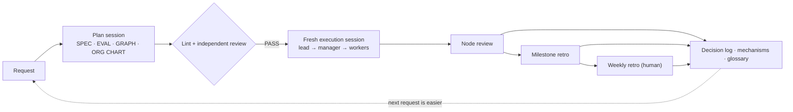

[English](README.md) · [日本語](README.ja.md) · [简体中文](README.zh-Hans.md) · [한국어](README.ko.md) · [Español](README.es.md)

# Graph Compound Engineering

[README en japonés](README.ja.md)

**Un manual para llevar a cabo trabajos de varios días con una organización de agentes de IA**, sin que el trabajo pierda el rumbo, sin aceptar un «¡terminado!» solo porque lo diga un agente y sin ahogar a la persona responsable en pequeñas comprobaciones.

Graph Compound Engineering (GCE) parte de [compound engineering](https://every.to/) —hacer que cada unidad de trabajo resulte más fácil que la anterior— y añade dos elementos necesarios cuando los agentes trabajan en equipo: un **grafo de trabajo** (qué se hace y en qué orden) y un **organigrama de puestos** (quién responde por cada cosa y qué nivel de modelo ocupa cada puesto).

- 📘 Manual completo: [HANDBOOK.md](HANDBOOK.md) (inglés) · [HANDBOOK.ja.md](HANDBOOK.ja.md) (日本語)
- 🧩 Plantillas que puedes copiar: [templates/en](templates/en) · [templates/ja](templates/ja)

## El problema

Cuando delegas un encargo considerable en agentes, fallan cuatro cosas:

1. El trabajo **se desvía** de su propósito.
2. Se aceptan **informes del propio agente** («todas las pruebas pasan») como prueba.
3. Nadie puede decir **en qué punto está el trabajo**.
4. La persona responsable acaba **enterrada en pequeñas comprobaciones**, así que nada se vuelve más fácil.

## Las ideas centrales

| Idea | En una línea | Manual |
|---|---|---|
| Tres documentos | SPEC (qué, por qué, cuándo está terminado) · GRAPH (qué, en qué orden) · ORG CHART (quién, cómo): se separan porque cambian a ritmos distintos y tienen responsables diferentes | §4 |
| Puestos, no modelos | Un puesto se dimensiona según el peso de las decisiones que toma. Reserva el modelo más capaz para juzgar y mantén bajo el coste de ejecución | §6 |
| Los encargos son archivos | Pasa rutas y diffs, no resúmenes. Nueve campos, incluidos un presupuesto y un punto de parada | §7.1 |
| Quien hace ≠ quien juzga | El puesto que hizo el trabajo nunca emite el veredicto final. Dos perspectivas en un mismo contexto cuentan como un solo testigo | §7.4 |
| Regla de decisión de tres vías | Consultar a una persona / registrar una suposición y continuar / continuar: se decide según haya una cuestión pendiente, no por el tamaño del encargo | §8.1 |
| Cinco condiciones de devolución | Detenerse y devolver el trabajo al nivel superior ante: 3 fallos consecutivos de comprobación, una decisión fuera de la especificación, un bloqueo por algo desconocido, un exceso de alcance o una decisión ya acordada que deja de sostenerse | §8.2 |
| Ciclo de mejora en tres niveles | Revisión del nodo (corregir) → retrospectiva del hito (reestructurar) → retrospectiva semanal (con aprobación humana) | §8.4 |
| Consolidar las lecciones | Primera vez: registrarlo. Segunda vez: impedirlo con un hook, una comprobación de lint o una prueba. Si se repite: llevar la estructura a revisión | §8.5 |
| Fijar solo los límites | Codificar de forma rígida solo lo que seguirá siendo necesario al mejorar los modelos: acciones irreversibles, permisos, topes y verificación externa | §10.3 |

## Empieza por algo pequeño

Necesitas una interfaz de línea de comandos para agentes y un gestor de incidencias (basta con una tabla en Markdown). La primera semana, haz solo cinco cosas:

1. Redacta **una especificación** con cuatro campos: propósito / criterios de aceptación («ejecuta esto, comprueba aquello») / fuera de alcance / puntos por determinar.
2. Entrega cada tarea al agente como un **archivo de encargo** ([plantilla](templates/en/brief.md)).
3. **Nunca dejes que quien hizo el trabajo lo juzgue**: usa una sesión nueva que reciba únicamente la especificación y el entregable, o ejecuta tú los comandos de aceptación.
4. Incluye la **regla de decisión y las condiciones de devolución** en cada encargo.
5. Fija el **formato de respuesta**: conclusión → evidencias → riesgos → siguiente paso → lo no verificado, más una línea con las preguntas abiertas.

Después, amplía el sistema con el mapa de trabajo, RACI, un puesto de gestión, un registro de decisiones y retrospectivas semanales (§13).

## A quién va dirigido

A desarrolladores y responsables de equipo que ya desarrollan con agentes y quieren delegar trabajos que abarcan varios días, sesiones y agentes. El manual no menciona productos concretos: describe los modelos por nivel de capacidad y trata las herramientas concretas como adaptadores intercambiables (§11).

## Estado

Un diseño vivo (a noviembre de 2026), fruto de aplicarlo en proyectos reales. No presenta afirmaciones numéricas sobre su eficacia; consulta sus limitaciones en el §17. Las incidencias y el debate son bienvenidos.

## Licencia

Texto y plantillas: [CC BY 4.0](LICENSE) © Kazuaand
