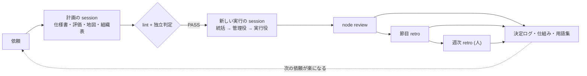

[English](README.md) · [日本語](README.ja.md) · [简体中文](README.zh-Hans.md) · [한국어](README.ko.md) · [Español](README.es.md)

# Graph Compound Engineering

[English README](README.md)

**AI agent の組織に、複数日にわたる仕事を任せるための手引きです。** 途中で目的からずれず、agent の「できました」をそのまま通さず、人間が細かい確認に追われない進め方をまとめています。

Graph compound engineering (GCE) は、「1 つの仕事が次の仕事を楽にするように積み上げる」compound engineering ([Every](https://every.to/) が広めた考え方) に、agent がチームで動く時に要る 2 つを足したものです。**仕事の地図 (work graph)** = 何をどの順でやるか、と **席の組織表** = 誰が責任を持ち、どの格の model をどこに座らせるか、です。

- 📘 本文: [HANDBOOK.ja.md](HANDBOOK.ja.md) (日本語) · [HANDBOOK.md](HANDBOOK.md) (English)
- 🧩 そのまま使える雛形: [templates/ja](templates/ja) · [templates/en](templates/en)

## 何が困るのか

大きめの仕事を agent に任せると、次の 4 つが起きます。

1. 途中で目的から **ずれる**。
2. 「test は全部通りました」という **自己申告** がそのまま通る。
3. 今 **どこまで進んだか** が分からなくなる。
4. 人間が **細かい確認に追われ**、結局楽にならない。

## 中心になる考え方

| 考え方 | ひとことで | 本文 |
|---|---|---|
| 3 冊の設計文書 | 仕様書 (何を・なぜ・何で完了か)・仕事の地図 (何を・どの順で)・組織表 (誰が・どう協調するか)。変わる速さと書き換えてよい人が違うので分ける | §4 |
| model でなく「席」 | 席は判断の重さで分けた立場。賢い model は判断に使い、実行は安く済ませる | §6 |
| 依頼書は file で渡す | 要約でなく場所と差分を渡す。予算と止まる条件を含む 9 項目 | §7.1 |
| 作る者 ≠ 判定する者 | 作った席は自分の成果を最終判定しない。同じ会話の 2 つの視点は 1 人の証人 | §7.4 |
| 判断 3 値 | 人に聞く / 仮定を登録して進む / 進む。分けるのは仕事の大きさでなく、論点の有無 | §8.1 |
| 戻し条件 5 つ | 検査の 3 回連続失敗・仕様の外の判断・未知の障害で進まない・担当範囲の超過・確定した決定が崩れる証拠 で止めて上へ返す | §8.2 |
| 改善 loop 3 段 | node review (小さな修正) → 節目 retro (構造の作り直し) → 週次 retro (人が承認) | §8.4 |
| 学びの昇格 | 1 回目は記録、2 回目は hook・lint・test で止める、それでも再発したら構造を議題に | §8.5 |
| 固定するのは境界だけ | model が賢くなっても要るもの (取り返しのつかない操作・権限・上限・外部の検証) だけを決め打ちにする | §10.3 |

## 小さく始める

agent CLI 1 つと issue tracker 1 つ (無ければ markdown の表) があれば始められます。最初の 1 週間は次の 5 つだけです。

1. **仕様書を 1 枚** 書く。目的 / 受け入れ基準 (「これを実行するとこう出る」) / やらないこと / 未確定 の 4 欄だけ。
2. agent への依頼はすべて **依頼書の file** で渡す ([雛形](templates/ja/brief.md))。
3. **作った agent に自分の成果を判定させない**。仕様書と成果物の場所だけを渡した新しい session に判定させるか、受け入れ基準の command を自分で実行する。
4. **判断 3 値と戻し条件** を毎回依頼書に書く。
5. **返事の形** を固定する。結論 → 根拠 → リスク → 次 → 未確認 + 末尾に論点一覧 1 行。

慣れてきたら、仕事の地図・責任分担表 (RACI)・管理役・決定ログ・週次の振り返りを足していきます (§13)。

## 誰向けか

agent を使った開発の経験があり、複数日・複数 session・複数 agent にまたがる仕事を任せたい開発者やチームの責任者向けです。特定の製品名は出てきません。model は格 (tier) で書き、具体的な道具は差し替え可能な部品として扱います (§11)。

## 状態

実際の project で回しながら育てている設計です (2026-11 時点)。効果を数字では主張していません。限界は §17 にあります。issue や議論を歓迎します。

## License

本文と雛形: [CC BY 4.0](LICENSE) © Kazuaand
