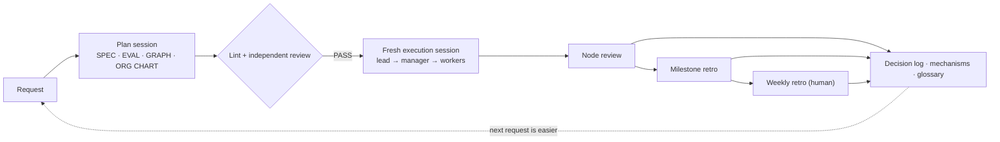

[English](README.md) · [日本語](README.ja.md) · [简体中文](README.zh-Hans.md) · [한국어](README.ko.md) · [Español](README.es.md)

# Graph Compound Engineering

[일본어 README](README.ja.md)

**여러 날에 걸친 작업을 AI 에이전트 조직으로 수행하기 위한 핸드북** — 작업이 목적에서 벗어나지 않게 하고, 에이전트의 말만 듣고 "완료!"를 인정하지 않으며, 사람이 자잘한 확인에 파묻히지 않도록 합니다.

Graph compound engineering(GCE)은 매 작업이 이전 작업보다 더 쉬워지도록 하는 [compound engineering](https://every.to/)에 에이전트가 팀으로 일할 때 필요한 두 가지를 더합니다. 바로 **작업 그래프**(무엇을 어떤 순서로 할 것인가)와 **역할별 자리로 구성한 조직도**(누가 책임을 지며, 각 자리에 어떤 등급의 모델을 배치할 것인가)입니다.

- 📘 전체 핸드북: [HANDBOOK.md](HANDBOOK.md) (영어) · [HANDBOOK.ja.md](HANDBOOK.ja.md) (일본어)
- 🧩 복사해서 쓸 수 있는 템플릿: [templates/en](templates/en) · [templates/ja](templates/ja)

## 해결하려는 문제

규모가 있는 일을 에이전트에게 맡기면 네 가지 문제가 생깁니다.

1. 작업이 원래 **목적에서 벗어납니다**.
2. **자체 보고**("모든 테스트 통과")가 증거로 받아들여집니다.
3. **현재 진행 상황**을 아무도 파악하지 못합니다.
4. 사람이 결국 **자잘한 확인에 파묻혀**, 일이 전혀 수월해지지 않습니다.

## 핵심 개념

| 개념 | 한 줄 설명 | 핸드북 |
|---|---|---|
| 세 가지 문서 | SPEC(무엇을, 왜, 언제 완료로 볼지) · GRAPH(무엇을 어떤 순서로) · ORG CHART(누가, 어떻게) — 변경 속도와 담당자가 다르므로 분리합니다 | §4 |
| 모델이 아닌 역할별 자리 | 자리는 판단의 무게에 맞춰 설계한 직책입니다. 판단에는 성능이 높은 모델을 쓰고, 실행 비용은 낮게 유지합니다 | §6 |
| 작업 지시서는 파일로 | 요약을 전달하는 대신 파일 위치와 변경 사항을 전달합니다. 예산과 중단 기준을 포함한 아홉 가지 항목을 씁니다 | §7.1 |
| 제작자 ≠ 판정자 | 결과물을 만든 자리가 최종 판정을 내리지 않습니다. 같은 컨텍스트 안에 두 관점이 있어도 증인은 한 명입니다 | §7.4 |
| 세 갈래 판단 규칙 | 사람에게 묻기 / 가정을 기록하고 진행하기 / 그대로 진행하기 — 작업 크기가 아니라 미해결 쟁점의 유무로 결정합니다 | §8.1 |
| 다섯 가지 상위 보고 조건 | 검증 3회 연속 실패, 명세 밖의 판단, 알 수 없는 사항 때문에 막힘, 범위 초과, 확정된 결정이 더 이상 성립하지 않을 때 작업을 멈추고 상위 담당자에게 돌려보냅니다 | §8.2 |
| 세 단계 개선 루프 | 노드 검토(부분 수정) → 마일스톤 회고(구조 개편) → 주간 회고(사람이 승인) | §8.4 |
| 교훈의 단계적 제도화 | 처음에는 기록합니다. 두 번째에는 훅, 린트 또는 테스트로 재발을 막습니다. 또 반복되면 구조 자체를 검토 안건에 올립니다 | §8.5 |
| 경계만 고정하기 | 모델이 발전해도 필요한 것만 코드로 강제합니다. 되돌릴 수 없는 작업, 권한, 상한선, 외부 검증이 여기에 해당합니다 | §10.3 |

## 작게 시작하기

에이전트 CLI 하나와 이슈 트래커 하나면 됩니다(Markdown 표도 괜찮습니다). 첫 주에는 다섯 가지만 하세요.

1. 목적 / 인수 기준("이것을 실행하면 이런 결과가 나와야 한다") / 범위 밖의 사항 / 미정 사항, 네 항목으로 **명세 하나**를 작성합니다.
2. 모든 작업을 **작업 지시서 파일**([템플릿](templates/en/brief.md))로 에이전트에게 전달합니다.
3. **만든 에이전트가 자기 작업을 판정하지 못하게 합니다.** 명세와 결과물만 받은 새 세션을 쓰거나, 인수 기준을 확인하는 명령을 직접 실행합니다.
4. 모든 작업 지시서에 **판단 규칙과 상위 보고 조건**을 넣습니다.
5. **응답 형식**을 고정합니다. 결론 → 증거 → 위험 → 다음 단계 → 미검증 사항 순으로 쓰고, 미해결 질문 목록을 한 줄로 덧붙입니다.

그다음 작업 지도, RACI, 관리자 자리, 의사결정 기록, 주간 회고로 확장하세요(§13).

## 대상 독자

이미 에이전트로 개발하고 있으며, 여러 날과 세션, 여러 에이전트에 걸친 작업을 위임하려는 개발자와 팀 리드를 위한 문서입니다. 핸드북은 특정 제품을 지정하지 않습니다. 모델은 등급으로 설명하고, 구체적인 도구는 교체 가능한 어댑터로 다룹니다(§11).

## 현재 상태

실제 프로젝트에서 운영한 경험을 정리한, 계속 발전 중인 설계입니다(2026년 11월 기준). 효과를 수치로 주장하지는 않습니다. 한계는 §17을 참고하세요. 이슈와 토론을 환영합니다.

## 라이선스

본문 및 템플릿: [CC BY 4.0](LICENSE) © Kazuaand
