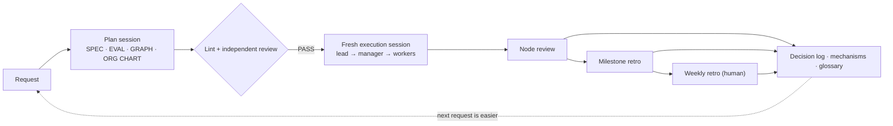

[English](README.md) · [日本語](README.ja.md) · [简体中文](README.zh-Hans.md) · [한국어](README.ko.md) · [Español](README.es.md)

# Graph Compound Engineering

[日本語版 README](README.ja.md)

**A handbook for running multi-day work through an organization of AI agents** — without the work drifting, without "done!" being accepted on an agent's word, and without the human drowning in small checks.

Graph compound engineering (GCE) takes [compound engineering](https://every.to/) — make every unit of work easier than the last — and adds two things it needs once agents work as a team: a **work graph** (what is done in what order) and an **org chart of seats** (who is accountable, and which model tier sits where).

- 📘 Full handbook: [HANDBOOK.md](HANDBOOK.md) (English) · [HANDBOOK.ja.md](HANDBOOK.ja.md) (日本語)
- 🧩 Templates you can copy: [templates/en](templates/en) · [templates/ja](templates/ja)

## The problem

Hand a sizable job to agents and four things go wrong:

1. The work **drifts** away from its purpose.
2. **Self-reports** ("all tests pass") are accepted as proof.
3. Nobody can tell **where things stand**.
4. The human ends up **buried in small checks**, so nothing gets easier.

## The core ideas

| Idea | In one line | Handbook |
|---|---|---|
| Three documents | SPEC (what, why, done) · GRAPH (what, in what order) · ORG CHART (who, how) — split because they change at different speeds and are owned by different people | §4 |
| Seats, not models | A seat is a position sized by the weight of its judgment. Spend the smart model on judgment, keep execution cheap | §6 |
| Briefs are files | Pass locations and diffs, not summaries. Nine fields, including a budget and a stop point | §7.1 |
| Maker ≠ judge | The seat that made the work never gives the final verdict. Two viewpoints in one context are one witness | §7.4 |
| Three-way decision rule | Ask a human / register an assumption and proceed / proceed — decided by whether there is an open issue, not by job size | §8.1 |
| Five return conditions | Stop and hand back up on: 3 consecutive check failures, a decision outside the spec, being stuck on an unknown, exceeding scope, a settled decision breaking | §8.2 |
| Three-level improvement loop | Node review (patch) → milestone retro (restructure) → weekly retro (a human approves) | §8.4 |
| Lesson promotion | First time: record it. Second time: stop it with a hook, lint or test. Again: put the structure on the agenda | §8.5 |
| Fix only the boundaries | Hard-code only what stays necessary as models improve: irreversible actions, permissions, caps, outside verification | §10.3 |

## Start small

You need one agent CLI and one issue tracker (a markdown table is fine). In the first week, do just five things:

1. Write **one spec** with four fields: purpose / acceptance criteria ("run this, see that") / out of scope / undetermined points.
2. Hand every task to an agent as a **brief file** ([template](templates/en/brief.md)).
3. **Never let the maker judge its own work** — use a fresh session given only the spec and the deliverable, or run the acceptance commands yourself.
4. Put the **decision rule and the return conditions** into every brief.
5. Fix the **reply format**: conclusion → evidence → risks → next → unverified, plus a one-line list of open questions.

Then grow into the work map, RACI, a manager seat, a decision log and weekly retros (§13).

## Who this is for

Developers and team leads who already build with agents and want to delegate work that spans days, sessions and several agents. The handbook names no specific products: models are described by tier, and concrete tools are treated as swappable adapters (§11).

## Status

A living design (as of 2026-11), distilled from running it on real projects. It makes no numerical claims about effectiveness; see §17 for its limits. Issues and discussion are welcome.

## License

Text and templates: [CC BY 4.0](LICENSE) © Kazuaand
