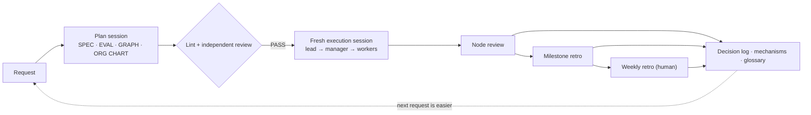

[English](README.md) · [日本語](README.ja.md) · [简体中文](README.zh-Hans.md) · [한국어](README.ko.md) · [Español](README.es.md)

# Graph Compound Engineering

[日语版 README](README.ja.md)

**通过 AI 智能体组织推进持续多天工作的实践手册**——让工作不偏离目标，让“完成了！”必须有证据支撑，也让人不再被琐碎的检查淹没。

Graph Compound Engineering（GCE）在[复利工程](https://every.to/)——让每一项工作都比上一项更容易——的基础上，加入了智能体团队协作所需的两项要素：**工作图**（做什么、按什么顺序做）和**岗位组织架构图**（谁负责、各岗位采用哪个层级的模型）。

- 📘 完整手册：[HANDBOOK.md](HANDBOOK.md)（英语）· [HANDBOOK.ja.md](HANDBOOK.ja.md)（日语）
- 🧩 可复制使用的模板：[templates/en](templates/en) · [templates/ja](templates/ja)

## 要解决的问题

把一项规模较大的工作交给智能体，通常会出现四个问题：

1. 工作逐渐**偏离**最初的目的。
2. **自我报告**（“所有测试都通过了”）被直接当成证据。
3. 没人能说清楚**工作进展到哪里了**。
4. 人类最终**被琐碎检查淹没**，工作并没有变得更轻松。

## 核心思想

| 思想 | 一句话说明 | 手册 |
|---|---|---|
| 三份文档 | SPEC（做什么、为什么做、怎样算完成）· GRAPH（做什么、先后顺序）· ORG CHART（谁来做、怎么做）——三者的变化频率和负责人不同，因此分开维护 | §4 |
| 按岗位配置，而非围绕模型分工 | 岗位按其所承担决策的重要程度设置。把强模型用在判断上，让执行保持低成本 | §6 |
| 简报以文件传递 | 传递文件位置与差异，而非转述摘要。包含九个字段，其中包括预算和停止条件 | §7.1 |
| 执行者 ≠ 裁判 | 产生成果的岗位不能作最终裁决。同一个上下文中的两个视角，仍然只算一个证人 | §7.4 |
| 三分支决策规则 | 询问人类／登记假设后继续／直接继续——依据是否存在未决问题，而非任务大小来决定 | §8.1 |
| 五项退回条件 | 遇到以下情况就停止并交回上级：连续三次检查失败、需要作出规格之外的决策、被未知问题卡住、超出范围、既定决策不再成立 | §8.2 |
| 三层改进循环 | 节点审查（局部修补）→ 里程碑复盘（调整结构）→ 每周复盘（由人类批准） | §8.4 |
| 将教训逐步固化 | 第一次：记录。第二次：用 hook、lint 或测试阻止重犯。再次发生：将结构性问题列入议程 | §8.5 |
| 只固定必要边界 | 仅将那些即使模型进步也仍然必要的约束写死：不可逆操作、权限、上限和外部验证 | §10.3 |

## 从小处开始

你只需要一个智能体命令行工具和一个议题跟踪工具（Markdown 表格也可以）。第一周只做五件事：

1. 写**一份规格说明**，包含四个字段：目的／验收标准（“运行这个，应看到那个”）／范围之外的事项／待定问题。
2. 以**简报文件**的形式向智能体分派每项任务（[模板](templates/en/brief.md)）。
3. **绝不让执行者评判自己的工作**——使用只接收规格与交付物的全新会话，或由你亲自运行验收命令。
4. 在每份简报中加入**决策规则和退回条件**。
5. 固定**回复格式**：结论 → 证据 → 风险 → 下一步 → 未验证事项，另附一行未决问题清单。

之后再逐步引入工作图、RACI 职责分工表、管理岗位、决策日志和每周复盘（§13）。

## 适用人群

适合已经在使用智能体开发，并希望将持续多天、跨越多个会话、涉及多个智能体的工作委派出去的开发者和团队负责人。手册不指定任何具体产品：按层级描述模型，将具体工具视为可替换的适配器（§11）。

## 当前状态

这是一套持续演进的设计（截至 2026 年 11 月），提炼自真实项目中的运行经验。它不对成效作任何数值性主张；局限性见 §17。欢迎提交议题并参与讨论。

## 许可证

正文与模板：[CC BY 4.0](LICENSE) © Kazuaand
